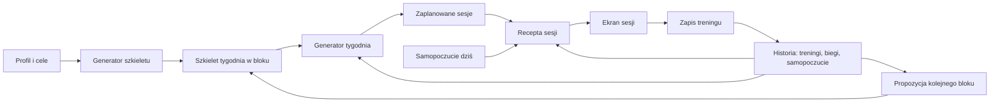

# 03 · Silnik treningowy

Silnik to deterministyczny zestaw reguł, który z profilu, planu i historii wylicza, co i z jakim obciążeniem zrobić na kolejnym treningu. Działa w całości na urządzeniu, bez sieci i bez AI.

Wszystkie liczby w tym dokumencie to **wartości startowe**. Znajdują się w jednym pliku konfiguracyjnym silnika (§13) i będą strojone po pierwszych tygodniach używania.

## 1. Zasady działania

1. **Czyste funkcje.** Silnik nie czyta bazy, zegara ani sieci. Dostaje dane wejściowe (w tym „dzisiejszą” datę) i zwraca wynik. Te same dane zawsze dają ten sam wynik.
2. **Historia jest źródłem prawdy.** Silnik nie trzyma własnego stanu typu „aktualny ciężar”. Za każdym razem wylicza receptę z zapisanych treningów. Poprawienie starego wpisu automatycznie zmienia kolejne recepty.
3. **Każda decyzja ma powód.** Wynik zawiera kod powodu i dane do wyjaśnienia (§12).
4. **Podział ról.** Struktura planu (jakie sesje, jakie ćwiczenia, ile serii) zmienia się rzadko: na granicy bloku albo na życzenie użytkownika. Liczby (ciężar, powtórzenia, tempo, dystans) silnik wylicza na bieżąco.
5. **Użytkownik ma pierwszeństwo.** Ręcznie zmienione elementy są oznaczone i silnik ich nie nadpisuje.
6. **Tryb dziennika poprzedza programowanie.** Dopóki programowanie nie jest włączone, plan nie ma tygodni ani recept: użytkownik wybiera trening z „Moich treningów”, a pola serii wypełnia ostatni wynik. Po włączeniu programowania silnik przejmuje te sesje jako szkielet i liczy recepty z zebranej historii, więc ćwiczenia z historią nie wymagają kalibracji.



## 2. Pojęcia

| Pojęcie | Znaczenie |
|---|---|
| **Plan** | Aktywny program użytkownika; ciąg bloków |
| **Blok** | Mezocykl: kilka tygodni pracy i tydzień deloadu. Ma jeden szkielet tygodnia |
| **Szkielet tygodnia** | Wzorzec tygodnia: lista sesji siłowych (ze slotami) i biegowych (z typami) oraz preferowane dni |
| **Slot** | Miejsce na ćwiczenie w sesji siłowej: ćwiczenie, liczba serii, zakres powtórzeń |
| **Zaplanowana sesja** | Konkretna jednostka w konkretnym tygodniu i dniu |
| **Recepta** | Wyliczone liczby dla sesji: ciężar, powtórzenia i RIR dla serii; kroki, dystans i tempo dla biegu |
| **RIR** | Zapas powtórzeń: ile jeszcze dałoby się zrobić w serii |
| **RPE** | Odczuwany wysiłek w skali 1–10 (dla biegu i całej sesji) |
| **e1RM** | Szacowany ciężar maksymalny na jedno powtórzenie |
| **VDOT** | Wskaźnik formy biegowej według Danielsa; z niego liczone są tempa |
| **Wykonanie referencyjne** | Ostatnie miarodajne wykonanie ćwiczenia, od którego liczona jest progresja (§5.2) |

## 3. Struktura bloku

- Domyślnie **4 tygodnie pracy + 1 tydzień deloadu**. Liczba tygodni pracy: 3–6, do zmiany przez użytkownika.
- Siła i bieganie mają wspólny tydzień deloadu, żeby regeneracja była pełna.
- Docelowy RIR maleje w kolejnych tygodniach pracy:

| Tydzień pracy (z 4) | 1 | 2 | 3 | 4 | Deload |
|---|---|---|---|---|---|
| Ćwiczenia wielostawowe | 3 | 2 | 2 | 1 | 4+ |
| Ćwiczenia izolowane | 2 | 1 | 1 | 0 | 4+ |

Wzór dla dowolnej liczby tygodni `N`: `RIR(t) = round(start − (start − koniec) × (t − 1) / (N − 1))`, gdzie start/koniec to 3/1 dla wielostawowych i 2/0 dla izolowanych. Dla początkujących koniec to 2 (wielostawowe) i 1 (izolowane).

## 4. Siła: szkielet

### 4.1 Podział tygodnia

| Sesji siłowych / tydz. | Domyślny podział |
|---|---|
| 2 | Całe ciało A / B |
| 3 | Góra / Dół / Całe ciało |
| 4 | Góra A / Dół A / Góra B / Dół B |
| 5 | Góra / Dół / Push / Pull / Nogi |
| 6 | Push / Pull / Nogi × 2 (z ostrzeżeniem przy 3 lub więcej biegach) |

### 4.2 Sloty i dobór ćwiczeń

Szablon sesji to uporządkowana lista ról. Rola wskazuje wzorzec ruchu lub partię, a ćwiczenie jest dobierane z biblioteki.

Role: pchanie poziome, pchanie pionowe, ciągnięcie poziome, ciągnięcie pionowe, przysiad (dominacja kolan), zgięcie w biodrze (dominacja bioder), jednonóż, izolacja danej partii (barki bok, barki tył, biceps, triceps, czworogłowe, dwugłowe, pośladki, łydki, brzuch).

Dobór ćwiczenia do slotu, w kolejności:

1. ćwiczenie przypięte przez użytkownika,
2. zgodność ze sprzętem i brak na liście wykluczonych,
3. brak obciążenia obszaru zgłoszonego jako bolesny,
4. różne ćwiczenia w sesjach A i B dla tej samej roli,
5. ćwiczenie z poprzedniego bloku, jeśli robiło postęp,
6. kolejność domyślna z biblioteki.

Przykład szablonu „Góra A” (4 sesje / tydz.):

| # | Rola | Domyślne ćwiczenie | Serie × zakres |
|---|---|---|---|
| 1 | Pchanie poziome | Wyciskanie sztangi na ławce poziomej | 3 × 6–10 |
| 2 | Ciągnięcie poziome | Wiosłowanie sztangą w opadzie | 3 × 8–12 |
| 3 | Pchanie pionowe | Wyciskanie hantli nad głowę siedząc | 3 × 8–12 |
| 4 | Ciągnięcie pionowe | Ściąganie drążka wyciągu do klatki | 3 × 10–15 |
| 5 | Barki bok | Wznosy hantli bokiem | 3 × 12–20 |
| 6 | Triceps | Prostowanie ramion na wyciągu | 2 × 10–15 |
| 7 | Biceps | Uginanie ramion z hantlami | 2 × 10–15 |

Zakresy domyślne: wielostawowe główne 6–10, wielostawowe pomocnicze 8–12, izolowane 10–15 lub 12–20.

### 4.3 Objętość tygodniowa

Liczona w seriach roboczych na partię. Seria liczy się jako 1 dla partii głównej ćwiczenia i 0,5 dla pomocniczej.

| Serie / tydz. na partię | Początkujący | Średnio zaaw. | Zaawansowany |
|---|---|---|---|
| Minimum (utrzymanie) | 4 | 6 | 6 |
| Start domyślny | 8 | 10 | 12 |
| Partia priorytetowa | 10 | 14 | 16 |
| Maksimum | 14 | 20 | 24 |

Partie: klatka, plecy, barki, biceps, triceps, czworogłowe, dwugłowe, pośladki, łydki, brzuch.

### 4.4 Korekta nóg pod bieganie

Objętość nóg jest skalowana obciążeniem biegowym, żeby nie kumulować zmęczenia.

| Obciążenie biegowe | Mnożnik serii na nogi |
|---|---|
| ≤ 2 biegi i < 20 km / tydz. | 1,0 |
| 3 biegi lub 20–40 km / tydz. | 0,85 |
| ≥ 4 biegi lub > 40 km / tydz. | 0,7 |

Wynik nigdy nie spada poniżej minimum z tabeli 4.3. Przy priorytecie biegowym > 50% generator preferuje ćwiczenia nóg o niższym koszcie zmęczenia (np. suwnica zamiast ciężkiego przysiadu ze sztangą), a serie na łydki ogranicza do minimum.

### 4.5 Szacowany czas sesji

`czas = 5 min rozgrzewki + Σ po slotach [serie × (40 s pracy + przerwa)] + 1 min na zmianę ćwiczenia`

Przerwy przyjmowane do szacunku: wielostawowe główne 180 s, wielostawowe pomocnicze 150 s, izolowane 90 s. Aplikacja ich nie odmierza; służą wyłącznie do oszacowania czasu sesji.

Gdy czas przekracza limit użytkownika, generator usuwa serie od końca listy (najpierw izolowane partii niepriorytetowych), aż zmieści się w limicie, nie schodząc poniżej minimum objętości.

## 5. Siła: progresja

### 5.1 Model

**Podwójna progresja.** Na stałym ciężarze rośnie liczba powtórzeń w zadanym zakresie. Gdy wszystkie serie osiągną górę zakresu, rośnie ciężar, a powtórzenia wracają w dół zakresu.

Wszystkie serie robocze ćwiczenia mają ten sam ciężar. RIR jest podawany opcjonalnie; gdy użytkownik go nie poda, silnik przyjmuje RIR docelowy.

**Szacowane maksimum (e1RM)** dla serii: `e1RM = ciężar × (1 + (powtórzenia + RIR) / 30)`.

**Prognoza powtórzeń** na ciężarze `c` przy zapasie `RIR`: `powt = floor(30 × (e1RM / c − 1)) − RIR`.

### 5.2 Wykonanie referencyjne

Ostatnie wykonanie tego samego ćwiczenia, które spełnia wszystkie warunki:

- zrobiono co najmniej połowę zaplanowanych serii roboczych,
- nie był to tydzień deloadu,
- sesja nie była obniżona przez samopoczucie ≤ 2 (chyba że wykonane serie i tak osiągnęły cel bazowy),
- nie minęło więcej niż 28 dni.

**Ciężar roboczy** wykonania to ciężar, na którym zrobiono najwięcej serii roboczych (przy remisie wyższy). **e1RM wykonania** to najwyższe e1RM spośród jego serii.

### 5.3 Tabela decyzji

Silnik sprawdza warunki po kolei i stosuje pierwszy pasujący.

| # | Warunek | Decyzja | Recepta |
|---|---|---|---|
| 1 | Brak historii ćwiczenia | `CALIBRATE` | Tryb kalibracji (§5.4) |
| 2 | Tydzień deloadu | `DELOAD` | Ciężar × 0,9; serie × 0,5 (w górę, min. 1); powtórzenia = dół zakresu; RIR 4+ |
| 3 | Od ostatniego wykonania minęło > 28 dni | `RETURN_FROM_BREAK` | Ciężar − 5% za każdy pełny tydzień przerwy ponad 2 (maks. −20%); powtórzenia = dół zakresu + 1 |
| 4 | Pierwszy tydzień bloku, ćwiczenie ma historię | `BLOCK_START` | Ciężar bez zmian; powtórzenia = prognoza z e1RM dla RIR pierwszego tygodnia, w granicach zakresu. Gdy prognoza < dół zakresu: ciężar o jeden skok w dół, aż prognoza zmieści się w zakresie |
| 5 | Zakres powtórzeń slotu inny niż w wykonaniu referencyjnym | `RANGE_CHANGE` | Ciężar = `e1RM / (1 + (środek zakresu + RIR) / 30)`, zaokrąglony w dół do skoku |
| 6a | Jakakolwiek seria < dół zakresu, pierwszy raz | `HOLD_BELOW_RANGE` | Ten sam ciężar; cel = dół zakresu w każdej serii |
| 6b | Jakakolwiek seria < dół zakresu, drugi raz z rzędu | `REDUCE` | Ciężar − 10% (w dół do skoku); cel = środek zakresu |
| 7 | Wszystkie serie ≥ góra zakresu **i** prognoza na ciężarze + skok ≥ dół zakresu | `ADD_WEIGHT` | Ciężar + skok; powtórzenia = prognoza, w granicach [dół, góra − 1] |
| 7a | Jak w 7, a średni podany RIR ≥ docelowy + 2 | `ADD_WEIGHT_FAST` | Ciężar + 2 skoki, o ile prognoza ≥ dół zakresu |
| 7b | Wszystkie serie ≥ góra zakresu, ale prognoza na wyższym ciężarze < dół zakresu | `EXTEND_REPS` | Ten sam ciężar; cel = poprzednie powtórzenia + 1 (dozwolone do góry zakresu + 5) |
| 8 | Średni podany RIR ≤ docelowy − 2 (było znacznie ciężej niż planowano) | `HOLD_HARD` | Ten sam ciężar i te same powtórzenia |
| 9 | Pozostałe przypadki | `ADD_REPS` | Ten sam ciężar; w każdej serii poprzednie powtórzenia + 1, najwyżej do góry zakresu. Gdy średni podany RIR ≥ docelowy + 2: + 2 (`ADD_REPS_FAST`) |

Reguła 7b chroni lekkie ćwiczenia, w których jeden skok to duży procent ciężaru (np. wznosy bokiem z 8 na 10 kg).

Zaokrąglenia: ciężar zawsze do siatki skoku danego ćwiczenia, do najbliższej wartości, chyba że reguła mówi „w dół”. Prognoza powtórzeń jest liczona z tolerancją numeryczną, żeby wynik 9,9999 nie został obcięty do 9. Skoki domyślne: sztanga 2,5 kg, hantle 2 kg (na rękę), maszyny i wyciągi 5 kg; do zmiany w ustawieniach i per ćwiczenie.

### 5.4 Kalibracja

Pierwsze wykonanie ćwiczenia:

1. Recepta: „Dobierz ciężar na około {środek zakresu} powtórzeń z zapasem {RIR}”.
2. Po zapisaniu pierwszej serii silnik liczy e1RM i podpowiada ciężar na pozostałe serie: `e1RM / (1 + (środek zakresu + RIR) / 30)`, zaokrąglony do skoku. Podpowiedź pojawia się tylko wtedy, gdy pierwsza seria wyszła poza zakres.
3. Ta sesja staje się wykonaniem referencyjnym.

### 5.5 Stagnacja

Ćwiczenie jest oznaczane jako **w stagnacji**, gdy e1RM nie wzrosło w trzech kolejnych wykonaniach referencyjnych. W bieżącym bloku nic się nie zmienia poza oznaczeniem. Przy czwartym wykonaniu bez postępu aplikacja podpowiada: reset (−10% i odbudowa powtórzeń) albo zamianę ćwiczenia. Generator kolejnego bloku traktuje takie ćwiczenia jako pierwsze do rotacji (§10).

### 5.6 Ćwiczenia szczególne

- **Z masą ciała** (podciąganie, dipy): obciążenie = masa ciała + dodatkowy ciężar (ujemny przy odciążeniu). Progresja jak wyżej, na dodatkowym ciężarze, ze skokiem 2,5 kg. Gdy dodanie ciężaru nie jest możliwe, obowiązuje reguła 7b.
- **Na czas** (deska): zamiast powtórzeń sekundy; krok +5 s; zakres np. 30–60 s.
- **Jednostronne:** zapisywane raz, z założeniem tej samej pracy na obie strony.

### 5.7 Przykład

Wyciskanie na ławce, 3 serie, zakres 6–10, skok 2,5 kg, blok 4 + 1.

| Tydzień | RIR docelowy | Recepta | Wykonanie | Decyzja na kolejny raz |
|---|---|---|---|---|
| 1 | 3 | 80 kg × 8, 8, 7 | 8, 8, 7 | `ADD_REPS` → 9, 9, 8 |
| 2 | 2 | 80 kg × 9, 9, 8 | 9, 9, 9 | `ADD_REPS` → 10, 10, 10 |
| 3 | 2 | 80 kg × 10, 10, 10 | 10, 10, 10 | `ADD_WEIGHT`: e1RM = 80 × (1 + 12/30) = 112; na 82,5 kg przy RIR 1 prognoza 9 → 82,5 kg × 9 |
| 4 | 1 | 82,5 kg × 9, 9, 9 | 9, 8, 8 | wykonanie referencyjne dla kolejnego bloku |
| 5 (deload) | 4+ | 75 kg × 6, 6 (2 serie) | — | nie jest oceniane |
| 1 nowego bloku | 3 | `BLOCK_START`: e1RM = 82,5 × (1 + 10/30) = 110; przy RIR 3 prognoza 7 → 82,5 kg × 7, 7, 7 | | |

## 6. Bieganie

### 6.1 Forma (VDOT)

VDOT liczony jest z dystansu `d` (m) i czasu `t` (min) wzorami Danielsa–Gilberta:

```
v     = d / t                                            (m/min)
VO2   = −4,60 + 0,182258 × v + 0,000104 × v²
F     = 0,8 + 0,1894393 × e^(−0,012778 × t) + 0,2989558 × e^(−0,1932605 × t)
VDOT  = VO2 / F
```

Tempo dla zadanego procentu VDOT: `VO2 = procent × VDOT`, po czym `v` z równania kwadratowego powyżej, a tempo = `1000 / v` min/km.

Źródła wartości VDOT, w kolejności ważności:

1. **Wynik testu lub zawodów** wpisany przez użytkownika: ustawia VDOT wprost.
2. **Każda aktywność biegowa**: liczony jest VDOT z jej dystansu i czasu. Jeśli jest wyższy od bieżącego, bieżący rośnie do tej wartości, najwyżej o 2 punkty na raz. Spokojne biegi dają niskie wartości, więc w praktyce działają tu tylko mocne, ciągłe biegi.
3. **Odczucia z akcentów** (§6.6).
4. **Brak danych w onboardingu:** z opisu „biegam swobodnie X km w Y min” silnik przyjmuje, że to tempo odpowiada 66% VDOT. Dla „zaczynam” VDOT = 30 i plan startowy (§6.4).

### 6.2 Tempa treningowe

| Typ | Symbol | % VDOT | Docelowe RPE | Przykład dla VDOT 38,3 (5 km w 25:00) |
|---|---|---|---|---|
| Regeneracyjny | Rec | < 62% | 2–3 | wolniej niż 6:57 /km |
| Spokojny, długi | E, L | 62–70% | 3–4 | 6:20–6:57 /km |
| Maratoński | M | 78–82% | 5–6 | ok. 5:41 /km |
| Progowy (tempo) | T | 86–88% | 7 | ok. 5:16 /km |
| Interwałowy | I | 95–100% | 8–9 | ok. 4:51 /km |
| Rytmy | R | ok. 106% | krótko, szybko, luźno | ok. 4:32 /km |

Tempo jest pokazywane jako zakres (dla T, I, R: wartość ± 5 s/km). Biegi spokojne mają priorytet odczucia nad tempem: „swobodna rozmowa”.

### 6.3 Szkielet tygodnia biegowego

| Biegów / tydz. | Jednostki | Udział w kilometrażu |
|---|---|---|
| 1 | spokojny | 100% |
| 2 | akcent, długi | 40 / 60 |
| 3 | spokojny, akcent, długi | 25 / 30 / 45 |
| 4 | spokojny, akcent, spokojny z rytmami, długi | 20 / 25 / 20 / 35 |
| 5 | spokojny, akcent I, spokojny, akcent T, długi | 15 / 22 / 15 / 20 / 28 |

Drugi akcent w tygodniu (5 biegów) pojawia się tylko przy priorytecie biegowym ≥ 50% i poziomie co najmniej średnio zaawansowanym. W innym wypadku zastępuje go bieg spokojny.

Ograniczenia biegu długiego: najwyżej 150 minut i najwyżej o 2 km dłuższy niż najdłuższy bieg z ostatnich 3 tygodni.

### 6.4 Akcenty

Rodzaj akcentu zmienia się co tydzień. Domyślna rotacja zależy od celu:

| Cel | Rotacja akcentów w tygodniach pracy |
|---|---|
| Ogólna forma | T, I, T, I |
| 5 km / 10 km | I, T, I, I |
| Półmaraton / maraton | T, I, T, T (od fazy budowania długi bieg z odcinkiem M) |

Każdy akcent to rozgrzewka 10–15 min E, część główna i schłodzenie 10 min E. Część główna jest skalowana czasem pracy:

| Typ | Przepisy części głównej | Czas pracy (tydzień 1 → 4) |
|---|---|---|
| T | bieg ciągły w tempie T; albo odcinki 5–8 min w tempie T z przerwą 1–2 min truchtu | 15 → 25 min (zaawansowani do 40) |
| I | odcinki 2–5 min (lub 400–1200 m) w tempie I; przerwa truchtem równa 50–100% czasu odcinka | 10 → 18 min |
| R | 6–10 × 20–30 s szybko, przerwa 60–90 s truchtu; dodawane do biegu spokojnego | — |
| Podbiegi | 6–10 × 45–60 s pod górę mocno, powrót truchtem | zamiennie z I |

**Plan startowy** (dla „zaczynam” lub < 10 km / tydz.): pierwszy blok bez akcentów; same biegi spokojne (w razie potrzeby marszobieg, np. 4 min biegu + 1 min marszu), rytmy od trzeciego tygodnia.

**Tydzień deloadu:** akcent zastąpiony biegiem spokojnym z rytmami.

### 6.5 Progresja objętości

- Kilometraż tygodnia 1 pierwszego bloku = obecny tygodniowy kilometraż z onboardingu (nie mniej niż 3 km na bieg).
- W tygodniach pracy: `km(t) = km(1) × 1,07^(t−1)`.
- Deload: 75% kilometrażu ostatniego tygodnia pracy.
- Kolejny blok startuje z poziomu trzeciego tygodnia poprzedniego bloku (dwa kroki w przód, jeden w tył), o ile realizacja biegowa bloku wyniosła ≥ 80%.
- Sufit: wartość użytkownika albo domyślna dla celu. Po jego osiągnięciu kilometraż stoi, a rośnie czas pracy w akcentach.

| Cel | Domyślny sufit km / tydz. (3 / 4 / 5 biegów) |
|---|---|
| Ogólna forma | 25 / 32 / 40 |
| 5 km / 10 km | 30 / 40 / 50 |
| Półmaraton | 40 / 50 / 60 |
| Maraton | 50 / 60 / 70 |

Przy priorytecie siłowym > 60% sufit jest mnożony przez 0,8.

Reakcja na realizację poprzedniego tygodnia:

| Wykonany kilometraż względem planu | Kolejny tydzień |
|---|---|
| ≥ 80% | zgodnie z progresją |
| 50–80% | powtórzenie planowanego kilometrażu |
| < 50% | większa z wartości: wykonane × 1,1 lub plan × 0,8 |

### 6.6 Aktualizacja formy z akcentów

Po każdym akcencie użytkownik podaje RPE. Docelowe RPE: T = 7, I = 8,5.

| Sygnał z dwóch kolejnych akcentów | Zmiana VDOT |
|---|---|
| Wykonane w całości, a RPE ≤ docelowe − 1 | + 0,5 |
| Przerwane lub RPE ≥ docelowe + 1,5 | − 0,5 |

Łącznie nie więcej niż ± 1 punkt na 3 tygodnie z tego źródła. Po przerwie w bieganiu dłuższej niż 2 tygodnie: − 1 punkt za każdy pełny tydzień ponad pierwszy, najwyżej − 5.

## 7. Układ tygodnia (harmonogram hybrydowy)

Silnik przypisuje sesje do dni tak, żeby ciężkie bodźce nie wchodziły sobie w drogę.

**Wejście:** dostępne dni, lista sesji siłowych (góra / dół / całe ciało) i biegowych (spokojny / akcent / długi), sesje przypięte do dni przez użytkownika, zgoda na dwa treningi dziennie, preferowany dzień biegu długiego, priorytet siła ↔ bieganie.

**Warunki twarde:**

- sesje tylko w dostępne dni; sesje przypięte zostają na swoich dniach,
- jedna sesja dziennie; przy zgodzie na dwie dozwolone pary to: siła + bieg spokojny oraz góra + akcent biegowy,
- nigdy tego samego dnia: dół + akcent, dół + bieg długi, dwie sesje siłowe, dwa biegi,
- co najmniej jeden dzień bez treningu,
- sesje siłowe zachowują kolejność z podziału (A przed B).

**Warunki miękkie** (kara punktowa za złamanie; wygrywa układ o najniższej sumie):

| Kara | Sytuacja |
|---|---|
| 10 | Akcent biegowy dzień po treningu dołu |
| 8 | Bieg długi dzień po treningu dołu |
| 8 | Trening dołu dzień po akcencie lub biegu długim |
| 6 | Akcent i bieg długi w kolejne dni |
| 5 | Ta sama część ciała w kolejne dni (góra–góra, dół–dół, całe ciało dzień po dniu) |
| 3 | Każdy dzień treningowy ponad 3 z rzędu |
| 2 | Bieg długi poza preferowanym dniem |
| 2 | Każdy dzień z dwiema sesjami |
| 2 | Dwa dni wolne obok siebie przy 4 lub więcej dniach treningowych z rzędu |

Przestrzeń rozwiązań jest mała (do 8 sesji, 7 dni, zachowana kolejność sesji siłowych), więc silnik przegląda wszystkie układy. Przy remisie wygrywa układ z wcześniejszymi dniami.

Jeśli najlepszy układ nadal łamie regułę o karze ≥ 8, plan pokazuje informację (np. „Interwały wypadają dzień po nogach; przy wybranych dniach nie da się inaczej”).

**Kolejność w dniu z dwiema sesjami:** najpierw modalność o wyższym priorytecie; zalecany odstęp co najmniej 6 godzin.

**Przykład** (4 × siła, 3 × bieg, dostępne wszystkie dni, zgoda na dwa treningi, bieg długi w niedzielę):

| Pon | Wt | Śr | Czw | Pt | Sob | Nd |
|---|---|---|---|---|---|---|
| Góra A + akcent | wolne | Dół A | Góra B + bieg spokojny | Dół B | wolne | Bieg długi |

Suma kar: 10 (akcent dzień po biegu długim: 6; dwa dni z dwiema sesjami: 4). Żadna reguła o karze ≥ 8 nie jest złamana. Akcent sąsiadujący z biegiem długim jest przy tym zestawie nieunikniony, bo każde inne miejsce akcentu wypada obok treningu dołu.

## 8. Gotowość i samopoczucie

Przed sesją jedno pytanie w skali 1–5 i opcjonalne flagi. Modyfikacja dotyczy tylko bieżącej sesji i nie zmienia ciężarów bazowych.

Pytanie pojawia się przy rozpoczynaniu dzisiejszej sesji. Przy wpisywaniu treningu po fakcie jest pomijane, a sesja jest traktowana jak wykonana bez modyfikacji.

### 8.1 Siła

| Ocena | Modyfikacja |
|---|---|
| 5, 4 | brak |
| 3 | RIR docelowy + 1; cele powtórzeń bez przyrostu (jak ostatnio) |
| 2 | Ciężar − 5%; o jedną serię mniej w ćwiczeniach mających ≥ 3 serie; RIR + 1 |
| 1 | Propozycja odpoczynku lub przeniesienia. Jeśli użytkownik trenuje: recepta jak w deloadzie |

### 8.2 Bieganie

| Ocena | Akcent | Bieg długi | Bieg spokojny |
|---|---|---|---|
| 5, 4 | bez zmian | bez zmian | bez zmian |
| 3 | wolniejsza granica zakresu tempa | bez zmian | bez zmian |
| 2 | zamiana na bieg spokojny, 70% czasu | − 25% dystansu | − 25% dystansu |
| 1 | odpoczynek lub 20–30 min bardzo spokojnie | odpoczynek | odpoczynek |

### 8.3 Flagi

| Flaga | Reakcja |
|---|---|
| Zakwasy w partii trenowanej dziś, ocena ≤ 3 | Ćwiczenia tej partii traktowane jak przy ocenie 2 |
| Zakwasy nóg, dziś akcent biegowy | Propozycja zamiany dni z najbliższym biegiem spokojnym; w innym wypadku jak ocena 2 |
| Ból obszaru (bark, łokieć, nadgarstek, dolne plecy, biodro, kolano, staw skokowy) | Lista zamienników dla ćwiczeń obciążających ten obszar; pytanie, czy wykluczyć je do odwołania |
| Choroba | Zalecenie odpoczynku; sesja do przeniesienia lub pominięcia |
| Słaby sen, stres | Obniżają efektywną ocenę o 1, jeśli użytkownik podał 4 lub 5 |

### 8.4 Wykrywanie zmęczenia

Silnik proponuje wcześniejszy deload, gdy w ostatnich 10 dniach wystąpią co najmniej dwa sygnały:

- spadek e1RM ≥ 3% w co najmniej dwóch ćwiczeniach wielostawowych w dwóch kolejnych sesjach,
- średnia ocena samopoczucia ≤ 2,5 z ostatnich 4 odpowiedzi,
- RPE sesji ≥ 9 w co najmniej dwóch sesjach o normalnej recepcie,
- dwa nieudane akcenty biegowe z rzędu.

Przyjęcie propozycji zamienia bieżący tydzień w deload i kończy blok.

## 9. Realizacja planu

### 9.1 W trakcie tygodnia

- Sesję można wykonać w dowolny dzień tygodnia („Zrób dziś”).
- Sesję można wpisać po fakcie, z datą treningu. Silnik porządkuje historię według daty treningu, a nie daty wpisu.
- Niewykonana sesja z poprzednich dni jest pokazywana jako zaległa, z akcjami „Zrób dziś” i „Pomiń”.
- Silnik nie przestawia sam pozostałych sesji; może zaproponować kolejność, gdy zaległa i dzisiejsza kolidują.

### 9.2 Przejście na nowy tydzień

Wykonywane przy pierwszym otwarciu aplikacji w nowym tygodniu, także offline.

1. Zamknięcie tygodnia: niewykonane sesje dostają status „pominięta”. Taką sesję nadal można uzupełnić wpisem po fakcie; wraca wtedy do statusu „wykonana”.
2. Realizacja = wykonane sesje / zaplanowane sesje.
3. Numer tygodnia w bloku:
   - realizacja ≥ 50% → kolejny tydzień,
   - realizacja < 50% → powtórzenie tego samego tygodnia (najwyżej raz w bloku; nie dotyczy deloadu),
   - brak jakiejkolwiek sesji przez 2 tygodnie bez zgłoszonej pauzy → traktowane jak przerwa (§9.3),
   - wpis po fakcie w zamkniętym tygodniu przelicza tę decyzję, dopóki w nowym tygodniu nie wykonano żadnej sesji.
4. Wygenerowanie sesji nowego tygodnia: układ dni (§7), kilometraż i przepisy biegów (§6), numery tygodnia dla RIR (§3).
5. Recepty siłowe są wyliczane przy otwarciu sesji, więc zawsze uwzględniają najnowsze wyniki. Podgląd w Planie pokazuje wartości przewidywane.

### 9.3 Pauza i powrót

Pauza zgłoszona (zakres dat) albo wykryta (2 tygodnie bez sesji):

- siła: reguła `RETURN_FROM_BREAK` dla każdego ćwiczenia,
- bieganie: kilometraż − 10% za każdy tydzień przerwy (maks. − 40%), pierwszy tydzień bez akcentu, korekta VDOT z §6.6,
- blok zaczyna się od tygodnia 1.

## 10. Kolejny blok

Propozycja powstaje na początku tygodnia deloadu, żeby użytkownik miał czas ją przejrzeć. Bez reakcji użytkownika nowy blok startuje z dotychczasowym szkieletem, a propozycja pozostaje do rozpatrzenia.

Reguły generatora (bez AI):

| Obszar | Reguła |
|---|---|
| Podział | Bez zmian, chyba że zmienił się profil (liczba dni, priorytety) |
| Ćwiczenia główne | Zostają co najmniej 2 bloki, o ile robią postęp i nie zgłoszono bólu |
| Ćwiczenia pomocnicze | W każdej sesji 1–2 zmieniane na inne o tej samej roli; w pierwszej kolejności te w stagnacji |
| Ćwiczenia przypięte | Nigdy nie są zmieniane |
| Objętość partii | Postęp i brak sygnałów zmęczenia → bez zmian. Stagnacja partii priorytetowej przy realizacji ≥ 80% → + 1–2 serie / tydz. Wcześniejszy deload lub sygnały zmęczenia → − 1–2 serie |
| Długość bloku | Wcześniejszy deload → o tydzień krótszy (min. 3 tygodnie pracy). Dwa bloki bez sygnałów zmęczenia → o tydzień dłuższy (maks. 6) |
| Bieganie | Kilometraż według §6.5; rotacja akcentów według celu |

Propozycja to lista zmian z powodami. Użytkownik akceptuje całość, wybrane zmiany albo żadną. Trener AI (jeśli włączony) może przygotować własną propozycję w tym samym formacie ([07](07-trener-ai.md)).

## 11. Walidator

Jeden zestaw limitów sprawdza każdy szkielet i każdą zmianę. Dla propozycji AI przekroczenie blokuje zmianę. Dla edycji ręcznych tylko ostrzega.

| Limit | Wartość |
|---|---|
| Serie tygodniowe na partię | w granicach minimum–maksimum z §4.3 |
| Serie na ćwiczenie w sesji | 1–6 |
| Ćwiczenia w sesji | ≤ 9 |
| Zakres powtórzeń | 3–30; góra ≥ dół + 2 |
| Szacowany czas sesji | ≤ limit użytkownika + 10% |
| Liczba sesji w tygodniu | ≤ liczba dostępnych miejsc w dostępnych dniach |
| Dni wolne | ≥ 1 w tygodniu |
| Kilometraż tygodnia | ≤ 115% średniej z ostatnich 3 tygodni wykonanych (nie dotyczy tygodni < 15 km) |
| Bieg długi | ≤ 50% kilometrażu przy ≤ 3 biegach, ≤ 40% przy 4 lub więcej; ≤ 150 min |
| Akcenty biegowe | ≤ 1 przy ≤ 4 biegach; ≤ 2 przy 5 lub więcej |
| Pary sesji w jednym dniu | tylko dozwolone w §7 |
| Ćwiczenie | istnieje w bibliotece, zgodne ze sprzętem, nie jest wykluczone |

## 12. Wyjaśnienia

Każda recepta niesie kod powodu i parametry. Interfejs zamienia je na jedno zdanie.

| Kod | Przykładowy tekst |
|---|---|
| `CALIBRATE` | „Pierwszy raz. Dobierz ciężar na około 10 powtórzeń z zapasem 2.” |
| `ADD_REPS` | „Ostatnio 80 kg × 8, 8, 7. Dziś po jednym powtórzeniu więcej.” |
| `ADD_WEIGHT` | „Ostatnio 80 kg × 10, 10, 10: góra zakresu. Dokładamy 2,5 kg.” |
| `EXTEND_REPS` | „Kolejny ciężar to za duży skok. Zostajemy na 8 kg i dokładamy powtórzenia.” |
| `HOLD_HARD` | „Ostatnio było ciężej niż planowano. Powtarzamy.” |
| `HOLD_BELOW_RANGE` | „Ostatnio poniżej zakresu. Jeszcze jedna próba na tym ciężarze.” |
| `REDUCE` | „Dwa razy poniżej zakresu. Zdejmujemy 10% i odbudowujemy.” |
| `BLOCK_START` | „Początek bloku: ten sam ciężar, większy zapas.” |
| `DELOAD` | „Tydzień lżejszy: mniej serii, mniejszy ciężar.” |
| `RETURN_FROM_BREAK` | „Wracasz po 4 tygodniach. Zaczynamy 10% lżej.” |
| `READINESS_2` | „Słabsze samopoczucie: o serię mniej i 5% lżej. Tylko dziś.” |
| `RUN_VOLUME_UP` | „Tydzień 3 bloku: 34 km (+7%).” |
| `RUN_VOLUME_HOLD` | „W zeszłym tygodniu 65% planu. Powtarzamy kilometraż.” |
| `VDOT_UP_RESULT` | „Nowy wynik 5 km: 24:10. Tempa szybsze o około 6 s/km.” |
| `USER_OVERRIDE` | „Ustawione ręcznie.” |

## 13. Parametry konfiguracyjne

Wszystkie stałe są w jednym miejscu (`engine/config.ts`).

| Grupa | Parametry |
|---|---|
| Blok | liczba tygodni pracy (4), RIR start/koniec (3/1, 2/0), mnożniki deloadu (ciężar 0,9, serie 0,5) |
| Progresja | stała e1RM (30), okno wykonania referencyjnego (28 dni), redukcja (10%), powrót (5% / tydz., maks. 20%), próg stagnacji (3 wykonania), próg przyspieszenia (RIR + 2), rozszerzenie zakresu (+5) |
| Skoki | sztanga 2,5; hantle 2; maszyna 5; masa ciała 2,5 |
| Szacowanie czasu sesji | 40 s na serię; przerwy przyjmowane do szacunku 180 / 150 / 90 s |
| Objętość | tabela §4.3, mnożniki nóg §4.4 |
| Bieg: tempa | procenty VDOT z §6.2, szerokość zakresu ± 5 s/km |
| Bieg: objętość | wzrost 7%, deload 75%, udziały §6.3, sufity §6.5, limit biegu długiego 150 min i + 2 km |
| Bieg: forma | krok ± 0,5, limit ± 1 na 3 tygodnie, maks. skok z aktywności + 2 |
| Harmonogram | kary z §7 |
| Gotowość | modyfikatory z §8, progi wykrywania zmęczenia |
| Realizacja | progi 50% i 80% |
| Walidator | limity z §11 |

## 14. Scenariusze testowe

Scenariusze są jednocześnie kryteriami akceptacji silnika. Każdy staje się testem automatycznym.

| # | Scenariusz | Oczekiwany wynik |
|---|---|---|
| S1 | Przebieg z przykładu §5.7 | Recepty jak w tabeli |
| S2 | Nowe ćwiczenie; pierwsza seria 60 kg × 15 w zakresie 8–12, RIR docelowy i podany 2 | Kalibracja; podpowiedź cięższego ciężaru na kolejne serie (e1RM 94 → 67,5 kg przy skoku 2,5) |
| S3 | Wznosy bokiem 8 kg × 20, 20, 20 w zakresie 12–20, skok 2 kg, RIR 1 | `EXTEND_REPS`: zostaje 8 kg, cel 21 |
| S4 | Dwa razy z rzędu seria poniżej zakresu | Za pierwszym razem `HOLD_BELOW_RANGE`, za drugim `REDUCE` o 10% |
| S5 | Samopoczucie 2 przed sesją, potem zwykła sesja | Sesja obniżona; kolejna recepta liczona od wykonania sprzed obniżenia |
| S6 | Poprawiono wpis sprzed tygodnia (10 → 8 powtórzeń) | Kolejna recepta zmienia się z `ADD_WEIGHT` na `ADD_REPS` |
| S7 | 5 km w 25:00 | VDOT 38,3; tempa jak w §6.2 z dokładnością do 2 s/km |
| S8 | Blok biegowy od 30 km | 30 → 32,1 → 34,3 → 36,8 → deload 27,6 → kolejny blok od 34,3 |
| S9 | Tydzień z 60% wykonanego kilometrażu | Kolejny tydzień powtarza planowany kilometraż |
| S10 | 4 × siła + 3 × bieg, wszystkie dni, dwa treningi dziennie dozwolone, bieg długi w niedzielę | Układ z przykładu w §7: suma kar 10, brak naruszeń o karze ≥ 8 |
| S11 | 4 × siła + 3 × bieg, tylko 4 dostępne dni | Układ z najniższą karą i informacją o nieuniknionym naruszeniu |
| S12 | Realizacja tygodnia 40% | Powtórzenie numeru tygodnia; drugi raz w bloku już nie |
| S13 | 5 tygodni bez wykonania ćwiczenia | `RETURN_FROM_BREAK`: − 15% |
| S14 | Sygnały zmęczenia: spadek e1RM w dwóch ćwiczeniach i średnie samopoczucie 2,3 | Propozycja wcześniejszego deloadu |
| S15 | Propozycja z 30 seriami na klatkę tygodniowo | Walidator odrzuca |
| S16 | Użytkownik przypiął ćwiczenie; generowany jest kolejny blok | Ćwiczenie zostaje |
| S17 | Zmiana zakresu z 6–10 na 10–15 przy e1RM 110 kg, RIR 3 | `RANGE_CHANGE`: 110 / (1 + 15,5/30) = 72,5 kg |
| S18 | Trening z niedzieli wpisany w poniedziałek, po przejściu tygodnia; realizacja rośnie z 40% do 60%; w nowym tygodniu nie ma jeszcze wykonanej sesji | Sesja zmienia status na „wykonana”; powtórzenie tygodnia zostaje cofnięte |
| S19 | Dwa treningi tego samego ćwiczenia wpisane w odwrotnej kolejności dat | Wykonaniem referencyjnym jest trening o późniejszej dacie treningu |
