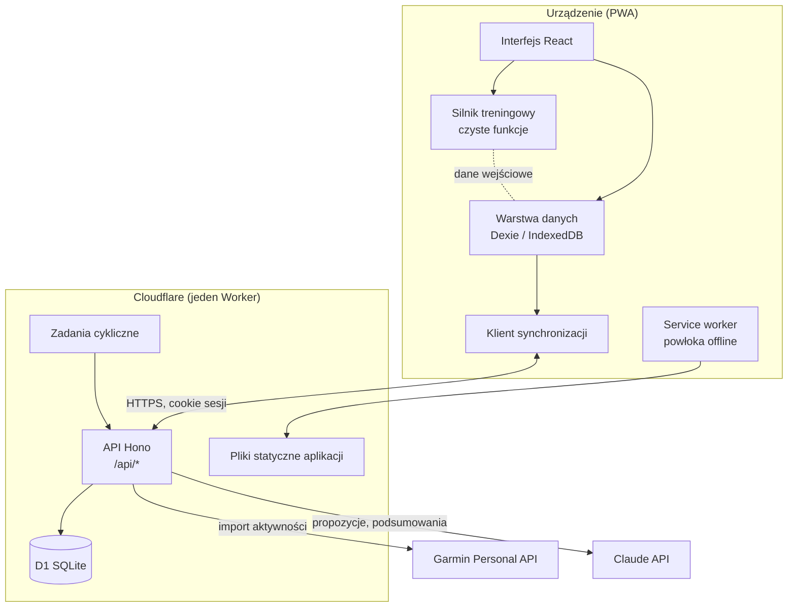
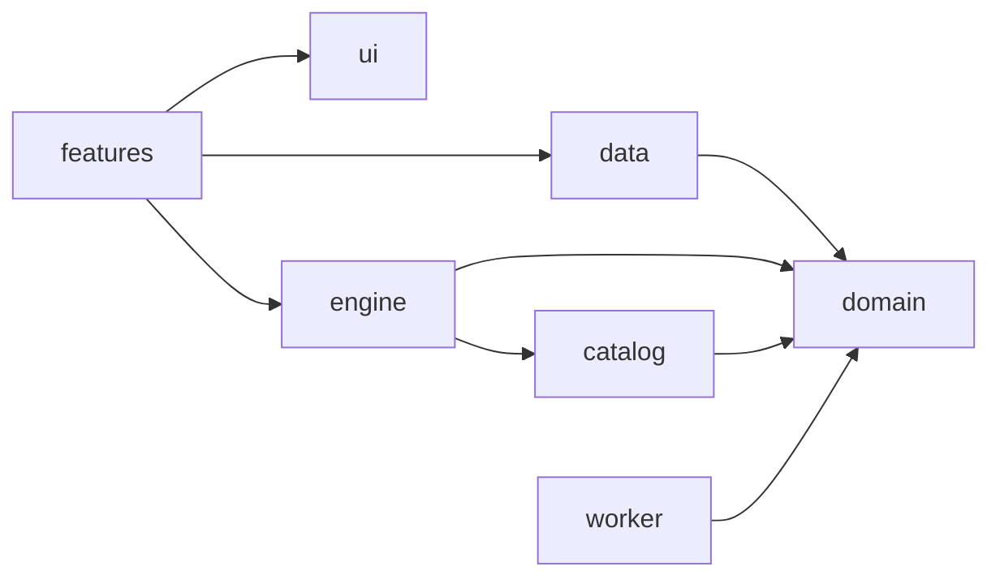

# 05 · Architektura

## 1. Przegląd

Aplikacja jest **local-first**: cała logika treningowa i wszystkie dane żyją na urządzeniu. Serwer jest cienki: przechowuje kopię danych do synchronizacji, trzyma sekrety (import biegów, AI) i pośredniczy w wywołaniach zewnętrznych.



Bez serwera aplikacja nadal działa w pełni na jednym urządzeniu. Serwer dodaje: kopię i wiele urządzeń, automatyczny import biegów, trenera AI.

## 2. Decyzje technologiczne

| Obszar | Wybór | Powód |
|---|---|---|
| Forma | PWA | Jedna baza kodu na telefon i komputer, instalacja bez sklepu, praca offline |
| Język | TypeScript (tryb ścisły) | Wspólne typy dla interfejsu, silnika i API |
| Interfejs | React + Vite | Dojrzały ekosystem, szybki cykl pracy, oficjalnie wspierany układ z Workerem |
| Style | Tailwind CSS + własne komponenty bazowe | Mała paczka, spójne zmienne motywu, brak ciężkiej biblioteki komponentów |
| Routing | React Router (tryb biblioteki, SPA) | Cztery zakładki i kilka ekranów pełnoekranowych |
| Dane lokalne | IndexedDB przez Dexie + `dexie-react-hooks` | Reaktywne zapytania (`useLiveQuery`), indeksy, migracje wersji |
| Walidacja i typy | Zod | Jedno źródło schematów dla klienta, serwera i odpowiedzi AI |
| Offline | `vite-plugin-pwa` (Workbox) | Precache powłoki aplikacji, kontrolowana aktualizacja |
| Wykresy | uPlot, ładowany leniwie | Kilkadziesiąt kB, szybki na telefonie |
| Serwer | Cloudflare Workers + Hono | Jeden Worker serwuje pliki i API; brak wstrzymywania projektu; brak limitu czasu trwania żądania |
| Baza w chmurze | Cloudflare D1 (SQLite) | Darmowy plan z zapasem, lokalna emulacja, odtwarzanie do punktu w czasie |
| Narzędzia | pnpm, `@cloudflare/vite-plugin` 1.x, Wrangler 4.x | Worker i lokalne D1 działają wewnątrz `vite dev`, bez Dockera |
| Testy | Vitest (silnik, API przez `@cloudflare/vitest-plugin`), Playwright (przepływy) | Silnik jest czysty, więc testy są szybkie i deterministyczne |
| AI | Claude API przez oficjalny `@anthropic-ai/sdk`, model `claude-opus-5-5` | Ustrukturyzowane odpowiedzi w schemacie Zod; szczegóły w [07](07-trener-ai.md) |

Wersje sprawdzone 2026-11-17: Wrangler 4.164, `@cloudflare/vite-plugin` 1.70 (wersja 2 jest w fazie RC i nie jest używana).

## 3. Struktura repozytorium

Jeden projekt, wyraźne granice modułów.

```
wrkout/
├── docs/                    dokumentacja (ten katalog)
├── src/
│   ├── domain/              typy i schematy Zod; wspólne dla aplikacji i Workera
│   ├── engine/              silnik: progresja, bieganie, harmonogram, gotowość,
│   │                        przejście tygodnia, kolejny blok, walidator, config
│   ├── catalog/             biblioteka ćwiczeń, szablony sesji, przepisy biegów
│   ├── data/                Dexie, repozytoria, migracje, eksport/import, klient sync
│   ├── features/            ekrany: today, session, run, plan, progress, profile,
│   │                        onboarding, coach, proposals
│   ├── ui/                  komponenty bazowe i motyw
│   ├── app/                 routing, powłoka, rejestracja service workera
│   └── main.tsx
├── worker/
│   ├── index.ts             aplikacja Hono + obsługa zadań cyklicznych
│   ├── routes/              auth, sync, integrations, ai
│   ├── integrations/        garmin (i ewentualnie inne źródła)
│   ├── ai/                  prompty, budowa zapytań, budżet
│   └── lib/                 sesja, szyfrowanie, limity prób
├── migrations/              migracje SQL dla D1
├── tests/
│   ├── engine/              scenariusze z dokumentu 03
│   └── e2e/                 Playwright
├── public/                  manifest, ikony
├── wrangler.jsonc
├── vite.config.ts
└── package.json
```

## 4. Warstwy i zależności



Reguły wymuszane lintem:

- `engine` importuje tylko `domain` i `catalog`. Nie zna Reacta, Dexie, sieci ani zegara systemowego. „Teraz” jest parametrem.
- `domain` nie importuje niczego z projektu.
- `worker` importuje tylko `domain` (schematy). Nie zawiera logiki treningowej.
- `features` nie odwołują się do IndexedDB bezpośrednio, tylko przez repozytoria z `data`.

## 5. Przepływ danych na urządzeniu

**Zapis.** Akcja użytkownika → repozytorium zapisuje dokument w IndexedDB (z `updatedAt` i znacznikiem „do wysłania”) → interfejs odświeża się przez zapytanie reaktywne → klient synchronizacji wysyła zmianę, gdy jest sieć.

**Odczyt.** Komponenty subskrybują zapytania Dexie. Nie ma osobnego magazynu stanu aplikacji; baza lokalna jest stanem. Stan czysto interfejsowy (np. otwarty panel) trzymany jest w komponentach.

**Recepty.** Przy otwarciu sesji `features/session` pobiera z repozytoriów historię ćwiczeń i kontekst (blok, tydzień, samopoczucie), woła `engine.prescribeStrengthSession(...)` i wyświetla wynik. Wynik jest zapisywany w logu sesji jako migawka recepty wraz z kodami powodów.

**Stan pochodny.** e1RM, VDOT, stagnacja i realizacja są funkcjami historii. Dla wydajności mogą być buforowane w pamięci; nigdy nie są zapisywane jako źródło prawdy.

**Przejście tygodnia.** Przy starcie aplikacji `engine.ensureCurrentWeek(...)` sprawdza datę i, jeśli trzeba, zamyka tydzień i generuje kolejny. Wygenerowane dokumenty mają deterministyczne identyfikatory (np. `week:2026-11-23`), więc dwa urządzenia, które zrobią to niezależnie offline, wytworzą te same dokumenty.

## 6. Synchronizacja

Model dokumentowy z rozstrzyganiem „wygrywa nowsza wersja dokumentu”. Pełny opis protokołu i struktur: [06 §6](06-model-danych.md#6-synchronizacja).

- Każda encja to dokument z `id`, `type`, `updatedAt`, `deleted`.
- Serwer przechowuje dokumenty jako JSON i nie interpretuje ich treści. Schemat danych ma jedno źródło (Zod w `domain`), a zmiana kształtu dokumentu nie wymaga migracji bazy w chmurze.
- Jedno żądanie `POST /api/sync` wysyła zmiany lokalne i odbiera zmiany z serwera od ostatniego kursora.
- Synchronizacja uruchamia się: przy starcie, po powrocie na pierwszy plan, po odzyskaniu sieci, kilka sekund po zmianie, po zakończeniu sesji.

Konflikty są rzadkie (jeden użytkownik) i dotyczą pojedynczego dokumentu, np. jednego treningu.

## 7. API

Wszystkie ścieżki pod `/api`, format JSON, uwierzytelnienie ciasteczkiem sesji (poza logowaniem i stanem zdrowia).

| Metoda i ścieżka | Opis |
|---|---|
| `GET /api/health` | Stan usługi i wersja |
| `POST /api/auth/login` | Klucz dostępu → ciasteczko sesji |
| `POST /api/auth/logout` | Usunięcie sesji |
| `GET /api/auth/me` | Stan zalogowania |
| `POST /api/sync` | Wysłanie zmian i pobranie zmian od kursora |
| `GET /api/export` | Pełny zrzut danych z serwera |
| `DELETE /api/data` | Usunięcie wszystkich danych użytkownika |
| `GET /api/integrations` | Stan integracji, data ostatniego importu, termin ważności klucza |
| `PUT /api/integrations/garmin` | Zapis klucza Garmin (szyfrowany po stronie serwera) |
| `DELETE /api/integrations/garmin` | Rozłączenie i usunięcie klucza |
| `POST /api/integrations/garmin/sync` | Import na żądanie |
| `POST /api/ai/block-proposal` | Propozycja kolejnego bloku (strumień) |
| `POST /api/ai/weekly-review` | Podsumowanie tygodnia (strumień) |
| `POST /api/ai/coach` | Polecenie do trenera (strumień) |
| `GET /api/ai/usage` | Zużycie i limit w bieżącym miesiącu |

Zadania cykliczne Workera: import z Garmina co 30 minut (gdy integracja jest aktywna), porządki raz na dobę (stare znaczniki usunięcia, stare próby logowania).

Błędy mają wspólny kształt `{ error: { code, message } }`. Kody istotne dla klienta: `unauthorized`, `rate_limited`, `budget_exceeded`, `integration_expired`, `validation_failed`, `upstream_unavailable`.

## 8. Uwierzytelnienie i bezpieczeństwo

Aplikacja ma jednego użytkownika, więc nie ma rejestracji ani haseł.

- **Klucz dostępu.** Losowy, co najmniej 128 bitów (np. 6 losowych słów). Jego skrót SHA-256 jest sekretem Workera. Logowanie porównuje skróty w stałym czasie. Powolne haszowanie haseł nie jest potrzebne przy losowym kluczu, a nie zmieściłoby się w limicie 10 ms procesora w darmowym planie.
- **Sesja.** Podpisany token (HMAC-SHA256) w ciasteczku `HttpOnly`, `Secure`, `SameSite=Lax`, ważny 180 dni i odnawiany przy użyciu. Zmiana sekretu podpisu wylogowuje wszystkie urządzenia.
- **Ograniczenie prób logowania.** Licznik w D1: najwyżej 5 prób na 15 minut z jednego adresu.
- **CSRF.** `SameSite=Lax`, sprawdzanie nagłówka `Origin`, API przyjmuje wyłącznie `application/json`.
- **Sekrety** (klucz AI, sekret sesji, klucz szyfrujący) są sekretami Workera. Klucz Garmin jest szyfrowany AES-GCM przed zapisem w D1 i nigdy nie wraca do klienta.
- **Nagłówki.** Restrykcyjna polityka CSP (zasoby i połączenia tylko z własnej domeny), `X-Content-Type-Options`, `Referrer-Policy`.
- **Dane w AI.** Do modelu trafia streszczenie zbudowane na urządzeniu, bez danych identyfikujących. Zasady per źródło danych: [07 §7](07-trener-ai.md#7-prywatno%C5%9B%C4%87).
- **Przyszłość.** Dokumenty na serwerze mają kolumnę właściciela, więc dodanie kolejnych użytkowników nie wymaga zmiany modelu.

## 9. PWA: możliwości i ograniczenia

Platformą docelową jest iPhone z aplikacją zainstalowaną na ekranie głównym. Stan na 2026-11-17.

| Funkcja | iPhone (aplikacja z ekranu głównego) | Wpływ na projekt |
|---|---|---|
| Praca offline, IndexedDB | Tak | Podstawa architektury |
| Trwałość danych | Aplikacja z ekranu głównego nie podlega 7-dniowemu czyszczeniu danych; `storage.persist()` działa | Aplikacja prosi o trwały magazyn; kopia w chmurze |
| Wspólne dane z Safari | Nie: zainstalowana aplikacja ma osobny magazyn | Logowanie i onboarding wykonuje się po instalacji |
| Synchronizacja w tle | Nie | Synchronizacja przy otwarciu i przy powrocie na pierwszy plan |
| Powiadomienia push | Tak, od iOS 16.4, po zgodzie | Opcjonalne przypomnienia w późniejszym etapie |
| Instalacja w UE | Wspierana | Brak ograniczeń |
| Dźwięk w tle, wibracja, blokada wygaszania ekranu | Ograniczone lub niedostępne | Bez znaczenia: aplikacja nie odmierza czasu (ADR-8) |

Aplikacja działa też w przeglądarce na komputerze (przegląd planu i postępów).

Aktualizacje: service worker pobiera nową wersję w tle, a aplikacja pokazuje baner. Przeładowanie następuje po dotknięciu banera albo przy kolejnym uruchomieniu, nigdy w trakcie sesji treningowej.

## 10. Wdrożenie i środowiska

| Środowisko | Opis |
|---|---|
| Lokalne | `pnpm dev`: Vite z Workerem i lokalnym D1 (Miniflare). Bez kont zewnętrznych; AI i import biegów zastąpione atrapami |
| Produkcja | Jeden Worker na Cloudflare: `pnpm deploy` buduje aplikację i wdraża ją razem z API. Adres `*.workers.dev` albo własna domena |

Konfiguracja Workera: pliki statyczne z obsługą SPA (`not_found_handling: single-page-application`), API uruchamiane przed plikami dla `/api/*` (`run_worker_first`), powiązanie z D1, harmonogram zadań.

Sekrety produkcyjne: `ACCESS_KEY_HASH`, `SESSION_SECRET`, `ENCRYPTION_KEY`, `ANTHROPIC_API_KEY`. Zmienne: `AI_MODEL`, `AI_MONTHLY_BUDGET_USD`.

Migracje D1 są wersjonowane w `migrations/` i stosowane komendą przy wdrożeniu.

CI (GitHub Actions): lint, sprawdzenie typów, testy jednostkowe, testy Playwright na zbudowanej aplikacji. Wdrożenie produkcyjne uruchamiane ręcznie lub po scaleniu do głównej gałęzi (decyzja przy M0).

## 11. Kopie i odtwarzanie

| Warstwa | Mechanizm |
|---|---|
| Urządzenie | IndexedDB z trwałym magazynem |
| Chmura | Kopia wszystkich dokumentów w D1 po każdej synchronizacji |
| Punkt w czasie | D1 Time Travel: 7 dni wstecz w darmowym planie |
| Plik | Eksport JSON z aplikacji (pełny, czytelny, importowalny) |

Usunięcia są znacznikami (`deleted`), a dokumenty usunięte są czyszczone po 90 dniach, więc przypadkowe usunięcie da się cofnąć.

## 12. Testy

| Poziom | Zakres | Narzędzie |
|---|---|---|
| Silnik | Każda reguła i scenariusze S1–S19 z [03 §14](03-silnik-treningowy.md#14-scenariusze-testowe); testy własności (np. recepta zawsze na siatce skoku, harmonogram nigdy nie łamie warunków twardych) | Vitest |
| Dane | Repozytoria, migracje, eksport/import, klient synchronizacji na atrapie IndexedDB | Vitest |
| API | Logowanie, sync (kolejność, konflikty, kursor), budżet AI, import na atrapie Garmina | Vitest w środowisku Workers |
| Przepływy | Onboarding, pełna sesja offline, wpis po fakcie, wznowienie sesji, edycja planu, synchronizacja dwóch kontekstów przeglądarki | Playwright (WebKit, profil iPhone'a) |
| AI | Zestaw przykładowych kontekstów; odpowiedzi muszą przejść schemat i walidator | Skrypt uruchamiany ręcznie (koszt) |

## 13. Obserwowalność

- Serwer: logi Workera (żądanie, kod, czas; bez treści danych treningowych).
- Klient: lokalny dziennik błędów widoczny w Profilu → O aplikacji, z możliwością skopiowania.
- AI: każde wywołanie zapisuje liczbę tokenów i koszt.

## 14. Koszty i limity

Limity darmowych planów (sprawdzone 2026-11-17) względem przewidywanego użycia jednej osoby:

| Zasób | Limit darmowy | Przewidywane użycie |
|---|---|---|
| Żądania Workera | 100 000 / dobę | < 500 / dobę |
| Czas procesora na żądanie | 10 ms | Sync i proxy mieszczą się; brak ciężkich obliczeń na serwerze |
| Czas trwania żądania | bez limitu przy otwartym połączeniu | Strumień AI do 2 minut |
| Zadania cykliczne | 5 | 2 |
| D1: rozmiar bazy | 500 MB | < 20 MB rocznie |
| D1: odczyty / zapisy | 5 mln / 100 tys. wierszy na dobę | < 10 tys. / < 1 tys. |
| Pliki statyczne | bez opłat | — |

Koszty stałe: 0 zł. Koszt AI: szacunkowo 1–3 USD miesięcznie, z twardym limitem ([07 §6](07-trener-ai.md#6-koszt-i-limit)). Plan płatny Workers (5 USD / mies.) nie jest potrzebny.

## 15. Rejestr decyzji (ADR)

### ADR-1 · PWA zamiast aplikacji natywnej
**Decyzja:** PWA. **Powód:** użytek prywatny, brak kont deweloperskich i sklepów, jedna baza kodu. **Koszt:** brak dostępu do HealthKit i brak pracy w tle na iOS. **Kiedy wrócić do tematu:** gdy potrzebna będzie aplikacja na zegarek albo odczyt danych zdrowotnych z telefonu.

### ADR-2 · Cloudflare Workers + D1 zamiast Supabase
**Decyzja:** jeden Worker z plikami statycznymi, API i D1. **Powód:** jedna usługa i jedno wdrożenie; darmowy projekt Supabase jest wstrzymywany po tygodniu bez aktywności (przerwa w treningach zatrzymałaby import i synchronizację do ręcznego wznowienia); lokalne środowisko bez Dockera; brak limitu czasu dla strumieni AI. **Koszt:** własne, proste uwierzytelnienie zamiast gotowego; SQLite zamiast Postgresa (bez znaczenia przy modelu dokumentowym).

### ADR-3 · Synchronizacja dokumentowa „wygrywa nowsza wersja”
**Decyzja:** serwer przechowuje nieprzezroczyste dokumenty JSON z kursorem zmian. **Powód:** jeden użytkownik, rzadkie konflikty, jedno źródło schematu, brak migracji po stronie serwera. **Koszt:** brak zapytań analitycznych w SQL i brak scalania pól przy równoczesnej edycji tego samego dokumentu. **Odrzucone:** CRDT i gotowe silniki synchronizacji (zbędna złożoność), tabele relacyjne po obu stronach (podwójne migracje).

### ADR-4 · Stan silnika wyliczany z historii
**Decyzja:** brak zapisywanego „aktualnego ciężaru”; recepty są funkcją logów. **Powód:** edycje historii działają same, brak konfliktów stanu między urządzeniami, proste testy. **Koszt:** przeliczanie przy każdym otwarciu sesji (dane są małe, więc pomijalne).

### ADR-5 · Reguły liczą, AI proponuje strukturę
**Decyzja:** ciężary, powtórzenia, tempa i kilometraż wylicza wyłącznie silnik; AI zwraca operacje na strukturze planu, które przechodzą walidator i wymagają akceptacji. **Powód:** przewidywalność, bezpieczeństwo, praca offline, niski koszt. **Koszt:** AI nie „czuje” pojedynczej serii; to rola reguł.

### ADR-6 · Klucz dostępu zamiast kont
**Decyzja:** jeden losowy klucz i ciasteczko sesji. **Powód:** jeden użytkownik, zero formularzy rejestracji i resetu hasła. **Kiedy wrócić do tematu:** przy drugim użytkowniku (wtedy passkeys).

### ADR-7 · Import biegów: Garmin Personal API i pliki; bez Stravy
**Decyzja:** automatyczny import przez osobiste API Garmina, uniwersalny import plików, wpis ręczny. Stravę pominięto decyzją użytkownika z 2026-11-24. **Powód:** zasady API Stravy obowiązujące od 2026-06-01 zakazują przechowywania danych dłużej niż 7 dni i użycia ich w aplikacjach AI, a dostęp wymaga płatnej subskrypcji. Garmin od 2026-10-21 udostępnia darmowe API do własnych danych. **Zastrzeżenie:** ustalenia pochodzą z wyciągów stron źródłowych i wymagają potwierdzenia przed budową integracji. Szczegóły: [08](08-integracje.md).

### ADR-8 · Aplikacja nie odmierza czasu
**Decyzja (użytkownik, 2026-11-24):** brak timera przerw, stopera treningu, sygnałów dźwiękowych i blokady wygaszania ekranu. Przerwy i czas odmierza zegarek. **Powód:** aplikacja ma być planerem i dziennikiem: szybkie wpisywanie, progres, raporty. **Skutki:** wpis na bieżąco i po fakcie to ten sam ekran; data treningu jest niezależna od chwili wpisu; czas trwania sesji jest polem opcjonalnym; ograniczenia iOS dotyczące dźwięku, wibracji i ekranu przestają mieć znaczenie.
