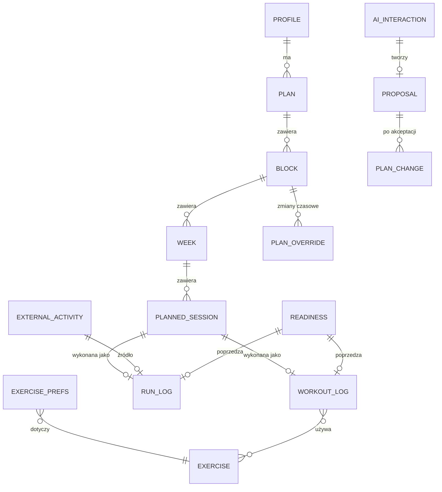

# 06 · Model danych i synchronizacja

## 1. Zasady

1. **Wszystko jest dokumentem.** Każda encja to dokument ze wspólną kopertą. Ten sam kształt obowiązuje w IndexedDB, w API i w eksporcie.
2. **Jedno źródło schematu.** Schematy Zod w `src/domain`. Typy TypeScript są z nich wyprowadzane.
3. **Logi są źródłem prawdy.** Wartości pochodne (e1RM, VDOT, stagnacja, realizacja) nie są zapisywane.
4. **Usunięcie to znacznik.** Dokument dostaje `deleted: true` i jest fizycznie czyszczony po 90 dniach.
5. **Identyfikatory.** Dokumenty tworzone przez użytkownika: UUID v7. Dokumenty generowane przez silnik lub import: identyfikator deterministyczny, żeby dwa urządzenia wytworzyły ten sam dokument.
6. **Daty.** Dzień jako `YYYY-MM-DD` w strefie użytkownika; chwile jako milisekundy od epoki.
7. **Jednostki w danych:** kilogramy, metry, sekundy. Formatowanie (km, min/km) należy do interfejsu.

### Koperta dokumentu

```ts
type Doc<T> = {
  id: string
  type: DocType
  updatedAt: number        // ms; zegar urządzenia w chwili ostatniej zmiany
  deleted?: true
  schemaVersion: number    // wersja kształtu `data` dla danego typu
  data: T
}
```

## 2. Mapa encji



| Typ dokumentu | Liczność | Identyfikator | Tworzy |
|---|---|---|---|
| `profile` | 1 | `profile` | użytkownik |
| `settings` | 1 | `settings` | użytkownik |
| `exercise` | własne ćwiczenia | UUID | użytkownik |
| `exercisePrefs` | 0–1 na ćwiczenie | `pref:<exerciseId>` | użytkownik |
| `plan` | 1 aktywny + archiwalne | UUID | silnik |
| `block` | kilka na plan | UUID | silnik / propozycja |
| `week` | 1 na tydzień kalendarzowy | `week:<poniedziałek>` | silnik |
| `plannedSession` | sesje tygodnia | `ps:<poniedziałek>:<templateId>` | silnik |
| `planOverride` | zmiany na zakres dat | UUID | użytkownik / AI |
| `workoutLog` | 1 na trening siłowy | UUID | użytkownik |
| `runLog` | 1 na bieg | UUID lub `run:<provider>:<externalId>` | użytkownik / import |
| `externalActivity` | 1 na zaimportowaną aktywność | `ext:<provider>:<externalId>` | serwer / import pliku |
| `readiness` | 0–1 na sesję | UUID | użytkownik |
| `fitnessEvent` | wyniki testów i zawodów | UUID | użytkownik |
| `bodyMetric` | pomiary | `bm:<data>` | użytkownik |
| `pause` | pauzy planu | UUID | użytkownik |
| `proposal` | propozycje zmian | UUID | silnik / AI |
| `planChange` | dziennik zmian planu | UUID | każda zmiana |
| `aiInteraction` | rozmowy i podsumowania | UUID | klient po odpowiedzi AI |

## 3. Typy wspólne

```ts
type Weekday = 1 | 2 | 3 | 4 | 5 | 6 | 7            // 1 = poniedziałek
type Day = string                                    // 'YYYY-MM-DD'

type MuscleGroup =
  | 'chest' | 'back' | 'shoulders' | 'biceps' | 'triceps'
  | 'quads' | 'hamstrings' | 'glutes' | 'calves' | 'abs'

type SlotRole =
  | 'push_horizontal' | 'push_vertical' | 'pull_horizontal' | 'pull_vertical'
  | 'squat' | 'hinge' | 'single_leg'
  | 'iso_delts_side' | 'iso_delts_rear' | 'iso_biceps' | 'iso_triceps'
  | 'iso_quads' | 'iso_hamstrings' | 'iso_glutes' | 'iso_calves' | 'iso_abs' | 'iso_chest' | 'iso_back'

type Equipment =
  | 'barbell' | 'dumbbell' | 'machine' | 'cable' | 'smith'
  | 'bodyweight' | 'kettlebell' | 'band' | 'bench' | 'rack' | 'pullup_bar'

type BodyArea = 'shoulder' | 'elbow' | 'wrist' | 'low_back' | 'hip' | 'knee' | 'ankle'

type SessionFocus = 'upper' | 'lower' | 'full' | 'push' | 'pull' | 'legs'
type RunType = 'easy' | 'easy_strides' | 'long' | 'tempo' | 'intervals' | 'hills' | 'recovery' | 'test' | 'race'
type Level = 'beginner' | 'intermediate' | 'advanced'
type Source = 'engine' | 'user' | 'ai'
```

## 4. Dokumenty

### 4.1 Profil i ustawienia

```ts
type Profile = {
  strengthLevel: Level
  runLevel: 'starter' | Level
  runSharePct: number                    // 0–100: priorytet biegania; siła = 100 − wartość
  priorityMuscles: MuscleGroup[]         // maks. 3
  availability: {
    days: Weekday[]
    strengthPerWeek: number              // 0–6
    runsPerWeek: number                  // 0–5
    maxSessionMin: number
    allowDoubles: boolean
    longRunDay?: Weekday
  }
  equipment: Equipment[]
  excludedExerciseIds: string[]
  painAreas: BodyArea[]
  runGoal: {
    kind: 'general' | '5k' | '10k' | 'half' | 'marathon'
    raceDate?: Day
    targetTimeSec?: number
    weeklyKmCap?: number
  }
  runBaseline: { weeklyKm: number; easyRun?: { distanceM: number; durationSec: number } }
  bodyWeightKg?: number
  hrMax?: number
  onboardedAt?: number
}

type Settings = {
  weekStart: Weekday                     // domyślnie 1
  theme: 'dark' | 'light' | 'system'
  increments: { barbell: number; dumbbell: number; machine: number; bodyweight: number }
  restSec: { compoundMain: number; compoundAux: number; isolation: number }
  timerSound: boolean
  blockWorkWeeks: number                 // 3–6
  ai: { enabled: boolean }
}
```

### 4.2 Ćwiczenia

Ćwiczenia wbudowane są w kodzie (`src/catalog`) i mają stałe identyfikatory tekstowe (np. `bench_press_barbell`). Dokument `exercise` opisuje tylko ćwiczenia własne. Kształt jest wspólny.

```ts
type Exercise = {
  name: string
  role: SlotRole
  primary: MuscleGroup
  secondary: MuscleGroup[]
  kind: 'compound_main' | 'compound_aux' | 'isolation'
  equipment: Equipment[]                 // wszystkie wymagane
  measure: 'reps' | 'time'
  load: 'external' | 'bodyweight' | 'assisted'
  unilateral: boolean
  stress: BodyArea[]                     // obszary, które ćwiczenie obciąża
  fatigue: 1 | 2 | 3                     // koszt zmęczenia ogólnego
  defaultRange: [number, number]
  incrementKind: 'barbell' | 'dumbbell' | 'machine' | 'bodyweight'
  hint?: string
}

type ExercisePrefs = {
  exerciseId: string
  increment?: number
  restSec?: number
  range?: [number, number]
  note?: string                          // np. ustawienie siedziska
}
```

### 4.3 Plan, blok, szkielet

```ts
type Plan = { name: string; status: 'active' | 'archived'; startedAt: Day }

type Block = {
  planId: string
  index: number                          // 1, 2, 3…
  startDate: Day                         // poniedziałek pierwszego tygodnia
  workWeeks: number
  status: 'planned' | 'active' | 'done'
  skeleton: SessionTemplate[]
  runPlan: {
    week1Km: number
    growthPct: number                    // domyślnie 7
    capKm: number
    qualityRotation: RunType[]           // np. ['tempo','intervals','tempo','intervals']
  }
  source: Source
  endedEarly?: boolean
}

type SessionTemplate = StrengthTemplate | RunTemplate

type StrengthTemplate = {
  id: string
  kind: 'strength'
  name: string                           // 'Góra A'
  focus: SessionFocus
  day?: Weekday                          // preferowany dzień
  dayPinned?: boolean                    // ustawiony przez użytkownika
  slots: Slot[]
}

type Slot = {
  id: string
  exerciseId: string
  role: SlotRole
  sets: number
  range: [number, number]
  rir?: number                           // nadpisanie docelowego RIR
  restSec?: number
  locked?: boolean                       // ćwiczenie przypięte: silnik i AI go nie zamieniają
  edited?: boolean                       // parametry zmienione ręcznie
}

type RunTemplate = {
  id: string
  kind: 'run'
  runKind: 'easy' | 'easy_strides' | 'quality' | 'long'
  day?: Weekday
  dayPinned?: boolean
  fixed?: { distanceM?: number; durationSec?: number; runType?: RunType }   // nadpisanie ręczne
}
```

### 4.4 Tydzień i zaplanowane sesje

```ts
type Week = {
  blockId: string
  startDate: Day
  weekIndex: number                      // 1…workWeeks, deload = workWeeks + 1
  isDeload: boolean
  repeated?: boolean                     // powtórzenie poprzedniego numeru tygodnia
  plannedRunM: number
  status: 'current' | 'closed'
  closed?: { strengthDone: number; strengthPlanned: number; runDoneM: number; runPlannedM: number }
  layoutIssues?: string[]                // nieuniknione naruszenia reguł układu
}

type PlannedSession = {
  weekId: string
  blockId: string
  templateId?: string                    // brak dla sesji dodanej jednorazowo
  kind: 'strength' | 'run'
  date: Day
  order: number                          // kolejność w dniu
  status: 'planned' | 'in_progress' | 'done' | 'skipped'
  skipReason?: string
  movedByUser?: boolean
  strength?: { name: string; focus: SessionFocus; slots: Slot[] }   // migawka; edytowalna „tylko ten tydzień”
  run?: RunPrescription
  logId?: string
}

type RunPrescription = {
  runType: RunType
  distanceM: number
  durationSec: number                    // szacunek
  targetRpe: number
  steps: RunStep[]
  reason: Reason
  edited?: boolean
}

type RunStep =
  | { kind: 'steady'; label: 'warmup' | 'main' | 'cooldown'; distanceM?: number; durationSec?: number; pace: PaceRange }
  | { kind: 'repeat'; times: number; work: { distanceM?: number; durationSec?: number; pace: PaceRange }; rest: { durationSec: number; mode: 'jog' | 'walk' | 'stand' } }

type PaceRange = { fastSecPerKm: number; slowSecPerKm: number; zone: 'Rec' | 'E' | 'M' | 'T' | 'I' | 'R' }
type Reason = { code: string; params: Record<string, number | string> }
```

### 4.5 Zmiany czasowe i pauzy

```ts
type PlanOverride = {
  from: Day
  to: Day
  ops: PlanOp[]                          // stosowane przy generowaniu tygodni z tego zakresu
  note: string
  source: Source
}

type Pause = { from: Day; to: Day; reason?: 'vacation' | 'illness' | 'other' }
```

### 4.6 Logi

```ts
type WorkoutLog = {
  plannedSessionId?: string
  date: Day
  startedAt: number
  endedAt?: number
  readinessId?: string
  context: { blockId?: string; weekIndex?: number; isDeload: boolean; readinessScore?: 1 | 2 | 3 | 4 | 5 }
  exercises: LoggedExercise[]
  sessionRpe?: number
  note?: string
}

type LoggedExercise = {
  exerciseId: string
  slotId?: string
  range: [number, number]
  targetRir: number
  prescription?: {                       // migawka recepty z chwili otwarcia sesji
    weightKg?: number
    reps: number[]
    baseWeightKg?: number                // przed modyfikacją samopoczucia
    reason: Reason
  }
  sets: LoggedSet[]
  note?: string
}

type LoggedSet = {
  kind: 'work' | 'warmup' | 'drop'
  weightKg: number                       // dla masy ciała: ciężar dodatkowy (ujemny przy odciążeniu)
  reps?: number
  durationSec?: number                   // ćwiczenia na czas
  rir?: number
  done: boolean
  doneAt?: number
}

type RunLog = {
  plannedSessionId?: string
  date: Day
  startedAt?: number
  runType: RunType
  distanceM: number
  movingSec: number
  elapsedSec?: number
  avgHr?: number
  maxHr?: number
  elevationM?: number
  laps?: { distanceM: number; durationSec: number; avgHr?: number }[]
  rpe?: number
  completion?: 'as_planned' | 'shortened' | 'aborted'
  note?: string
  source: 'manual' | 'garmin' | 'file' | 'strava'
  externalActivityId?: string
}

type ExternalActivity = {
  provider: 'garmin' | 'file' | 'strava'
  externalId: string
  sport: string
  startedAt: number
  distanceM: number
  movingSec: number
  elapsedSec?: number
  avgHr?: number
  maxHr?: number
  elevationM?: number
  laps?: { distanceM: number; durationSec: number; avgHr?: number }[]
  status: 'new' | 'linked' | 'ignored'
  importedAt: number
}

type Readiness = {
  date: Day
  at: number
  score: 1 | 2 | 3 | 4 | 5
  flags: { poorSleep?: true; sorenessLegs?: true; sorenessUpper?: true; illness?: true; stress?: true; pain?: BodyArea[] }
  plannedSessionId?: string
  applied: 'modified' | 'ignored' | 'moved' | 'none'
}

type FitnessEvent = { date: Day; kind: 'race' | 'test' | 'manual'; distanceM?: number; durationSec?: number; vdot: number }
type BodyMetric  = { date: Day; weightKg: number }
```

### 4.7 Propozycje, zmiany, AI

```ts
type Proposal = {
  createdAt: number
  source: 'engine' | 'ai'
  kind: 'next_block' | 'weekly_tweak' | 'coach' | 'early_deload'
  status: 'pending' | 'accepted' | 'partly_accepted' | 'rejected' | 'expired'
  summary: string
  items: {
    id: string
    op: PlanOp
    reason: string
    validation: { ok: boolean; issue?: string }
    accepted?: boolean
  }[]
  aiInteractionId?: string
}

type PlanChange = {
  at: number
  source: Source
  ops: PlanOp[]
  inverse: PlanOp[]                      // do cofnięcia zmiany
  proposalId?: string
}

type AiInteraction = {
  at: number
  kind: 'block_proposal' | 'weekly_review' | 'coach'
  userText?: string
  reply: string
  model: string
  usage: { inputTokens: number; outputTokens: number; costUsd: number }
  proposalId?: string
  weekStart?: Day
}
```

## 5. Operacje na planie

Każda zmiana struktury planu (ręczna, z silnika, z AI) jest wyrażona tym samym słownikiem operacji. Dzięki temu jeden walidator, jeden mechanizm cofania i jeden ekran propozycji obsługują wszystkie źródła.

```ts
type PlanOp =
  | { op: 'slot.swap';      sessionId: string; slotId: string; exerciseId: string }
  | { op: 'slot.add';       sessionId: string; slot: Omit<Slot, 'id'>; position?: number }
  | { op: 'slot.remove';    sessionId: string; slotId: string }
  | { op: 'slot.update';    sessionId: string; slotId: string; patch: Partial<Pick<Slot, 'sets' | 'range' | 'rir' | 'restSec' | 'locked'>> }
  | { op: 'slot.move';      sessionId: string; slotId: string; position: number }
  | { op: 'session.add';    template: SessionTemplate }
  | { op: 'session.remove'; sessionId: string }
  | { op: 'session.update'; sessionId: string; patch: { name?: string; day?: Weekday; dayPinned?: boolean; runKind?: RunTemplate['runKind']; fixed?: RunTemplate['fixed'] } }
  | { op: 'block.update';   patch: { workWeeks?: number; runPlan?: Partial<Block['runPlan']> } }
  | { op: 'block.deloadNow' }
  | { op: 'plan.pause';     from: Day; to: Day }
  | { op: 'profile.update'; patch: Partial<Profile> }
  | { op: 'exercise.exclude'; exerciseId: string }
```

Zasięg operacji:

| Zasięg | Gdzie trafia zmiana |
|---|---|
| Na stałe | `block.skeleton` bieżącego bloku (i kolejne bloki dziedziczą) |
| Na zakres dat | dokument `planOverride`; stosowany przy generowaniu tygodni z zakresu |
| Tylko ta sesja | migawka w `plannedSession` |

Zastosowanie operacji tworzy wpis `planChange` z operacjami odwrotnymi.

## 6. Synchronizacja

### 6.1 Protokół

Jedno żądanie robi wysyłkę i pobranie.

```
POST /api/sync
→ { cursor: number, changes: Doc[] }
← { cursor: number, changes: Doc[], more: boolean }
```

Serwer:

1. Dla każdego dokumentu z `changes`: zapisuje go, jeśli nie istnieje albo `updatedAt` jest nowszy lub równy zapisanemu. Zapis dostaje kolejny numer `rev` z globalnego licznika. Starsza wersja jest ignorowana.
2. Zwraca dokumenty z `rev` większym od przysłanego `cursor`, z pominięciem tych, które właśnie przyjął od tego klienta. Najwyżej 500 na odpowiedź; `more` sygnalizuje kolejną stronę.
3. `updatedAt` z przyszłości (ponad 5 minut względem zegara serwera) jest przycinany do czasu serwera.

Klient:

1. Wysyła dokumenty oznaczone jako zmienione (paczki po 200).
2. Po odpowiedzi zdejmuje oznaczenie z wysłanych, o ile nie zmieniły się w międzyczasie.
3. Każdy odebrany dokument zapisuje lokalnie, jeśli jest nowszy od lokalnego. Jeśli lokalny jest nowszy i oznaczony jako zmieniony, zostaje lokalny (pójdzie w kolejnej wysyłce).
4. Zapisuje nowy `cursor`.

### 6.2 Własności

- **Idempotentność.** Powtórzenie żądania nie zmienia wyniku.
- **Zbieżność.** Po synchronizacji obu urządzeń każde ma te same wersje dokumentów.
- **Konflikt** dotyczy jednego dokumentu; wygrywa późniejszy `updatedAt`. Granulacja dokumentów (jeden trening, jedna zaplanowana sesja, jeden blok) sprawia, że równoczesna edycja tego samego dokumentu jest mało prawdopodobna.
- **Dokumenty z serwera.** Zaimportowane aktywności (`externalActivity`) tworzy serwer; trafiają na urządzenia zwykłym pobraniem. Dopasowanie do planu i utworzenie `runLog` wykonuje klient, z deterministycznym identyfikatorem.

### 6.3 Wyzwalanie

Start aplikacji · powrót na pierwszy plan · odzyskanie sieci · 5 sekund po ostatniej zmianie · zakończenie sesji · ręcznie z Profilu. Nieudana próba jest ponawiana z rosnącym odstępem (do 5 minut).

## 7. Magazyn lokalny (IndexedDB)

Jedna tabela na typ dokumentu; dokument przechowywany w całości. Indeksy tylko tam, gdzie są zapytania.

| Tabela | Indeksy |
|---|---|
| `singletons` (`profile`, `settings`) | `id` |
| `exercises`, `exercisePrefs` | `id` |
| `plans`, `blocks` | `id`, `status` |
| `weeks` | `id`, `startDate`, `status` |
| `plannedSessions` | `id`, `weekId`, `date`, `status` |
| `workoutLogs` | `id`, `date`, `plannedSessionId`, `*exerciseIds` (indeks wielowartościowy do historii ćwiczenia) |
| `runLogs` | `id`, `date`, `plannedSessionId`, `externalActivityId` |
| `externalActivities` | `id`, `status`, `startedAt` |
| `readiness`, `fitnessEvents`, `bodyMetrics`, `pauses`, `planOverrides` | `id`, `date` lub `from` |
| `proposals` | `id`, `status` |
| `planChanges`, `aiInteractions` | `id`, `at` |
| `syncState` | `cursor`, `lastSyncAt`, `deviceId` |

Każda tabela dokumentów ma dodatkowo indeks `dirty` (dokumenty do wysłania).

## 8. Baza w chmurze (D1)

```sql
CREATE TABLE docs (
  owner          TEXT    NOT NULL DEFAULT 'owner',
  id             TEXT    NOT NULL,
  type           TEXT    NOT NULL,
  updated_at     INTEGER NOT NULL,
  rev            INTEGER NOT NULL,
  deleted        INTEGER NOT NULL DEFAULT 0,
  schema_version INTEGER NOT NULL,
  data           TEXT    NOT NULL,           -- JSON
  PRIMARY KEY (owner, id)
);
CREATE INDEX docs_rev ON docs (owner, rev);

CREATE TABLE meta (key TEXT PRIMARY KEY, value TEXT NOT NULL);        -- licznik rev, wersja

CREATE TABLE integrations (
  owner        TEXT NOT NULL DEFAULT 'owner',
  provider     TEXT NOT NULL,
  secret_enc   TEXT NOT NULL,                -- klucz zaszyfrowany AES-GCM
  expires_at   INTEGER,
  status       TEXT NOT NULL,                -- active | expired | error
  last_sync_at INTEGER,
  sync_cursor  TEXT,
  PRIMARY KEY (owner, provider)
);

CREATE TABLE ai_usage (
  month         TEXT PRIMARY KEY,            -- 'YYYY-MM'
  input_tokens  INTEGER NOT NULL DEFAULT 0,
  output_tokens INTEGER NOT NULL DEFAULT 0,
  cost_usd      REAL    NOT NULL DEFAULT 0,
  calls         INTEGER NOT NULL DEFAULT 0
);

CREATE TABLE login_attempts (ip_hash TEXT NOT NULL, at INTEGER NOT NULL);
CREATE INDEX login_attempts_at ON login_attempts (ip_hash, at);
```

Serwer nie interpretuje pola `data`. Wyjątek: tworzy dokumenty `externalActivity` z importu.

## 9. Biblioteka wbudowana

Dane w kodzie, wersjonowane razem z aplikacją:

| Zasób | Zawartość | Rozmiar docelowy |
|---|---|---|
| Ćwiczenia | Kształt `Exercise`; polskie nazwy; stałe identyfikatory | około 120 |
| Szablony sesji | Podziały z [03 §4.1](03-silnik-treningowy.md#41-podzia%C5%82-tygodnia) jako listy ról z domyślnymi seriami i zakresami | 6 podziałów |
| Przepisy biegów | Parametryzowane struktury akcentów z [03 §6.4](03-silnik-treningowy.md#64-akcenty) | około 10 |
| Teksty powodów | Kod → szablon zdania | według [03 §12](03-silnik-treningowy.md#12-wyja%C5%9Bnienia) |

Identyfikatory ćwiczeń wbudowanych nigdy się nie zmieniają. Usunięcie ćwiczenia z biblioteki oznacza oznaczenie go jako wycofanego, bez kasowania, żeby historia pozostała czytelna.

## 10. Eksport i import

Eksport to jeden plik JSON:

```json
{ "app": "wrkout", "exportedAt": 1795000000000, "formatVersion": 1, "docs": [ /* wszystkie dokumenty w kopercie */ ] }
```

Import scala dokumenty tą samą regułą co synchronizacja (wygrywa nowszy `updatedAt`). Import do pustej aplikacji odtwarza pełny stan.

## 11. Migracje

- **Kształt dokumentu:** pole `schemaVersion` per typ. Przy odczycie starszej wersji warstwa danych podnosi dokument do bieżącego kształtu funkcją migrującą i zapisuje go z powrotem.
- **IndexedDB:** zmiany tabel i indeksów przez wersje Dexie.
- **D1:** pliki SQL w `migrations/`; zmiany kształtu dokumentów ich nie wymagają.
- **Zgodność wstecz:** aplikacja odrzuca dokumenty z `schemaVersion` wyższą niż zna i prosi o aktualizację, zamiast je nadpisywać.
