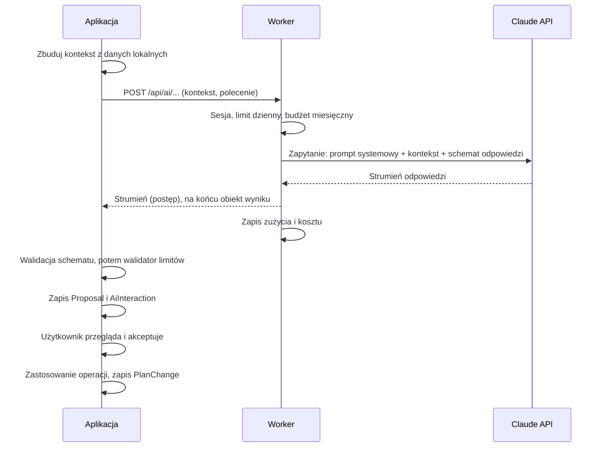

# 07 · Trener AI

Warstwa AI jest dodatkiem do silnika reguł. Aplikacja działa w pełni bez niej.

## 1. Rola i granice

| AI robi | AI nie robi |
|---|---|
| Proponuje strukturę kolejnego bloku: ćwiczenia, serie, zakresy, układ sesji, kierunek biegania | Nie wylicza ciężarów, powtórzeń, temp ani kilometrażu na konkretny dzień |
| Podsumowuje tydzień zwykłym językiem | Nie zapisuje niczego w planie samodzielnie |
| Zamienia polecenie tekstowe na listę zmian w planie | Nie omija walidatora limitów |
| Tłumaczy swoje propozycje | Nie udziela porad medycznych |

Trzy bezpieczniki obowiązują zawsze:

1. **Schemat.** Odpowiedź to dane w ustalonym schemacie, a nie dowolny tekst.
2. **Walidator.** Każda proponowana zmiana przechodzi limity z [03 §11](03-silnik-treningowy.md#11-walidator). Zmiana, która ich nie spełnia, jest zablokowana.
3. **Akceptacja.** Zmiany wchodzą do planu dopiero po zatwierdzeniu przez użytkownika, w całości albo wybiórczo.

## 2. Przypadki użycia

### 2.1 Propozycja kolejnego bloku

- **Kiedy:** na początku tygodnia deloadu (gdy jest sieć) albo na żądanie.
- **Wejście:** kontekst (§4) i propozycja bazowa silnika z [03 §10](03-silnik-treningowy.md#10-kolejny-blok).
- **Wyjście:** podsumowanie minionego bloku i lista zmian z powodami.
- **Wartość ponad reguły:** uwzględnia notatki użytkownika, łączy sygnały (np. stagnacja barków przy rosnącym kilometrażu), dobiera zamienniki ćwiczeń z wyczuciem, proponuje zmianę akcentów bloku.
- **Bez AI:** obowiązuje propozycja silnika.

### 2.2 Podsumowanie tygodnia

- **Kiedy:** po zamknięciu tygodnia, przy pierwszym otwarciu aplikacji z siecią; najwyżej raz na tydzień.
- **Wyjście:** 3–5 zdań, do trzech mocnych stron, do trzech uwag, opcjonalnie do trzech drobnych zmian.
- **Bez AI:** raport tygodnia liczony lokalnie jest dostępny zawsze; AI dodaje do niego komentarz.

### 2.3 Polecenie do trenera

- **Kiedy:** użytkownik pisze, co chce zmienić.
- **Przykłady:** „W czwartek nie mogę trenować”, „Boli mnie bark przy wyciskaniu”, „Od 1 do 7 grudnia mam tylko hantle do 20 kg”, „Chcę więcej pracy na barki”, „Za 10 tygodni biegnę 10 km”.
- **Wyjście:** krótka odpowiedź i, jeśli potrzeba, propozycja zmian (na stałe albo na zakres dat). Gdy brakuje informacji, jedno pytanie doprecyzowujące.
- **Bez AI:** te same zmiany da się wykonać ręcznie w Planie.

### 2.4 Pierwszy plan z opisu (później)

W onboardingu pole „Opisz, jak trenujesz i czego chcesz”. AI wypełnia odpowiedzi kreatora, a użytkownik je potwierdza.

## 3. Przebieg wywołania



Ustalenia techniczne:

| Element | Ustalenie |
|---|---|
| Biblioteka | Oficjalny `@anthropic-ai/sdk` w Workerze |
| Model | `claude-opus-5-5`; identyfikator w zmiennej `AI_MODEL` |
| Rozumowanie | Adaptacyjne (w tym modelu zawsze włączone); głębokość ustawiana parametrem `effort` |
| `effort` | `high` dla propozycji bloku, `medium` dla podsumowania i poleceń. Ustawiane jawnie, bo wartość domyślna tego modelu to `medium` |
| Format odpowiedzi | Ustrukturyzowane wyjście (`output_config.format`) ze schematem Zod |
| Strumieniowanie | Tak, dla wszystkich wywołań; odpowiedź bywa dłuższa niż minuta |
| Odmowa modelu | Sprawdzane `stop_reason`; przy `refusal` użytkownik widzi neutralny komunikat. Włączony serwerowy mechanizm zastępczy (`fallbacks`) |
| Ucięta odpowiedź | `stop_reason: max_tokens` traktowane jak błąd; brak częściowych propozycji |
| Pamięć podręczna promptu | Stały prefiks (prompt systemowy + biblioteka ćwiczeń) oznaczony do buforowania; zysk głównie przy kilku poleceniach z rzędu |
| Parametry próbkowania | Nie są wysyłane (model ich nie przyjmuje) |
| Rozmowa | Polecenie + do 6 ostatnich wymian z tej samej rozmowy, przesyłane przez klienta; serwer nie przechowuje historii |

Schemat odpowiedzi AI jest płaski (pole `op` i pola opcjonalne), a klient zamienia go na `PlanOp` z [06 §5](06-model-danych.md#5-operacje-na-planie). Płaski schemat jest odporniejszy na ograniczenia ustrukturyzowanego wyjścia niż zagnieżdżone unie.

## 4. Kontekst wejściowy

Kontekst buduje aplikacja z danych lokalnych. Jest zwięzły i nie zawiera danych identyfikujących.

| Część | Zawartość |
|---|---|
| Profil | Poziomy, priorytet siła ↔ bieganie, partie priorytetowe, dostępne dni, limity czasu, sprzęt, cel biegowy, obszary z dolegliwościami, wykluczone ćwiczenia |
| Plan | Bieżący blok: sesje, sloty (identyfikator i nazwa ćwiczenia, serie, zakres, przypięcie), numer tygodnia, plan biegowy |
| Biblioteka | Ćwiczenia zgodne ze sprzętem: identyfikator, nazwa, rola, partia, obciążane obszary |
| Siła: historia | Dla każdego ćwiczenia z planu: do 6 ostatnich wykonań (ciężar × powtórzenia, e1RM), trend, znacznik stagnacji; serie tygodniowe na partię z 5 tygodni |
| Bieganie: historia | Kilometraż planowany i wykonany z 8 tygodni, historia VDOT, wyniki akcentów (typ, ukończenie, RPE), biegi długie |
| Samopoczucie | Oceny i flagi z 4 tygodni, RPE sesji, realizacja planu |
| Notatki | Do 10 ostatnich notatek użytkownika z sesji |
| Silnik | Propozycja bazowa (dla bloku) i tabela limitów walidatora |
| Ramy | Dzisiejsza data, początek tygodnia, język odpowiedzi: polski |

Typowy rozmiar: 8–15 tys. tokenów.

## 5. Odpowiedzi

```ts
type AiProposal = {
  summary: string                              // 2–4 zdania
  scope: { kind: 'permanent' } | { kind: 'range'; from: Day; to: Day }
  items: { op: FlatPlanOp; reason: string }[]  // powód: jedno zdanie
}

type AiWeeklyReview = {
  summary: string                              // 3–5 zdań
  wins: string[]                               // maks. 3
  watch: string[]                              // maks. 3
  items: { op: FlatPlanOp; reason: string }[]  // maks. 3; może być puste
}

type AiCoachReply = {
  reply: string
  question?: string                            // gdy do zmiany brakuje informacji
  proposal?: AiProposal
}
```

Po stronie aplikacji:

1. Walidacja schematu. Niezgodna odpowiedź jest odrzucana w całości.
2. Sprawdzenie odwołań: identyfikatory sesji, slotów i ćwiczeń muszą istnieć.
3. Walidator limitów na planie po zastosowaniu każdej operacji. Pozycje niezgodne są oznaczone jako zablokowane, z przyczyną.
4. Ochrona zmian użytkownika: operacja zmieniająca przypięty slot jest zablokowana, chyba że polecenie użytkownika dotyczyło go wprost.
5. Zapis `Proposal` ze stanem „do rozpatrzenia”.

## 6. Koszt i limit

Ceny modelu `claude-opus-5-5` (stan na 2026-11-03): 4 USD za milion tokenów wejściowych, 20 USD za milion wyjściowych. Tokeny rozumowania liczą się jako wyjściowe.

| Wywołanie | Wejście | Wyjście (z rozumowaniem) | Koszt szacunkowy | Częstość |
|---|---|---|---|---|
| Propozycja bloku | ~12 tys. | ~10 tys. | ~0,25 USD | raz na 5 tygodni |
| Podsumowanie tygodnia | ~8 tys. | ~3,5 tys. | ~0,10 USD | raz w tygodniu |
| Polecenie do trenera | ~8 tys. | ~2,5 tys. | ~0,08 USD | kilka w tygodniu |

Szacunek miesięczny przy typowym użyciu: **1–3 USD**. To oszacowanie przed pomiarem; rzeczywiste zużycie pokaże licznik.

Zabezpieczenia po stronie serwera:

- **Budżet miesięczny** (`AI_MONTHLY_BUDGET_USD`, domyślnie 5). Po przekroczeniu serwer zwraca `budget_exceeded`, a aplikacja przechodzi w tryb bez AI do końca miesiąca.
- **Limit dzienny:** 30 wywołań.
- **Limit pojedynczej odpowiedzi** przez `max_tokens`.
- **Licznik** w Profilu: zużycie i koszt w bieżącym miesiącu.

Tabela cen jest w konfiguracji Workera i wymaga aktualizacji przy zmianie modelu.

## 7. Prywatność

- Do modelu trafia wyłącznie kontekst z §4: liczby treningowe, nazwy ćwiczeń, notatki z sesji. Bez imienia, adresu e-mail, lokalizacji i śladów GPS.
- Klucz API jest sekretem Workera. Przeglądarka nigdy go nie widzi.
- Serwer nie zapisuje treści zapytań ani odpowiedzi; zapisuje tylko liczniki zużycia. Treść rozmowy przechowuje aplikacja jako dokument `aiInteraction`.
- Zasady przetwarzania danych przez dostawcę (retencja, brak użycia do trenowania modeli) wynikają z warunków API Anthropic; do potwierdzenia w aktualnych warunkach przy uruchamianiu M5.

**Zasady per źródło danych biegowych.** Dostawcy danych mogą ograniczać użycie ich danych z AI, dlatego kontekst jest filtrowany według pola `source` biegu:

| Źródło biegu | Dystans, czas, tętno w kontekście AI |
|---|---|
| Wpis ręczny | Tak |
| Import pliku | Tak |
| Garmin Personal API | Zależnie od warunków API; sprawdzenie jest zadaniem M4, przed uruchomieniem AI |

Dla biegów ze źródła niedozwolonego AI dostaje tylko to, co wpisał użytkownik (RPE, ukończenie, notatka), oraz wartości planowane.

## 8. Prompty

Prompty systemowe są plikami w `worker/ai/prompts/`, wersjonowanymi w repozytorium. Jeden prompt na przypadek użycia, ze wspólną częścią:

- **Rola:** trener przygotowania siłowego i biegowego dla jednej osoby trenującej hybrydowo; cel: sylwetka i ogólna sprawność.
- **Zasady merytoryczne:** priorytety użytkownika, zarządzanie zmęczeniem między siłą a biegiem, stabilność ćwiczeń głównych, małe zmiany zamiast rewolucji, pierwszeństwo regeneracji przy sygnałach zmęczenia.
- **Granice:** tylko operacje ze słownika; tylko ćwiczenia z przekazanej biblioteki; limity walidatora podane w kontekście; bez liczb dla ciężarów i temp; bez diagnoz medycznych (przy bólu: ominięcie obciążenia i sugestia konsultacji).
- **Zmiany użytkownika:** przypięte elementy zostają, chyba że polecenie mówi inaczej.
- **Styl:** po polsku, krótko, konkretnie, bez motywacyjnych frazesów. Każdy powód w jednym zdaniu odwołującym się do danych.
- **Niepewność:** gdy danych jest za mało, lepiej zadać jedno pytanie albo nie proponować zmiany.

Kontekst jest przekazywany jako dane w wiadomości użytkownika, oddzielony od polecenia. Treść notatek użytkownika jest traktowana jak dane, a nie instrukcje.

## 9. Błędy i tryb bez AI

| Sytuacja | Zachowanie |
|---|---|
| Brak sieci, brak klucza, AI wyłączone | Funkcje AI ukryte lub z jedną linią informacji; plan prowadzi silnik |
| Przekroczony budżet | Komunikat z datą odnowienia; jak wyżej |
| Błąd dostawcy lub limit zapytań | Jedna automatyczna ponowna próba; potem komunikat i możliwość ponowienia |
| Odmowa modelu | Neutralny komunikat; brak propozycji |
| Odpowiedź niezgodna ze schematem lub ucięta | Odrzucona w całości; możliwość ponowienia |
| Wszystkie pozycje zablokowane przez walidator | Odpowiedź tekstowa pokazana, z informacją, dlaczego zmian nie da się zastosować |

Aplikacja nigdy nie czeka na AI, żeby pozwolić trenować: nowy blok i nowy tydzień powstają z reguł.

## 10. Ocena jakości

Przed włączeniem funkcji i po każdej zmianie promptu:

1. **Zestaw kontrolny:** 10–15 zapisanych kontekstów (stagnacja, zmęczenie, ból barku, wyjazd z ograniczonym sprzętem, niska realizacja, cel biegowy z datą, użytkownik początkujący).
2. **Kryteria automatyczne:** odpowiedź zgodna ze schematem; wszystkie pozycje przechodzą walidator; brak zmian w elementach przypiętych; liczba zmian w rozsądnych granicach.
3. **Przegląd ręczny:** czy propozycje mają sens treningowy i czy powody odwołują się do danych.

Zestaw uruchamia się ręcznie, bo każde uruchomienie kosztuje.
