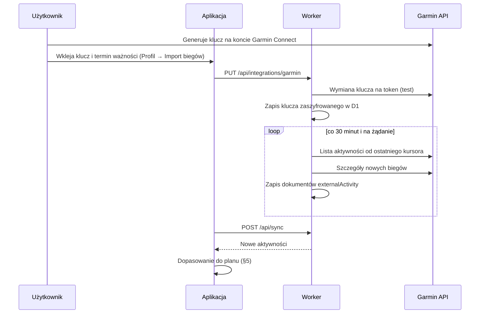

# 08 · Integracje: import biegów

## 1. Źródła danych

| Źródło | Automatyczne | Status | Kamień milowy |
|---|---|---|---|
| Wpis ręczny | Nie | Zawsze dostępny | M1 |
| Import pliku (FIT, GPX, TCX) | Nie, jedno dotknięcie na plik | Planowany; działa z każdym zegarkiem i aplikacją | M5 |
| Garmin Personal API | Tak | Planowany jako główne źródło automatyczne; wymaga sprawdzenia na żywym kluczu | M5 |
| Strava API | — | **Pominięta** decyzją użytkownika z 2026-11-24 (§6) | — |

Każde źródło tworzy ten sam znormalizowany dokument `externalActivity` ([06 §4.6](06-model-danych.md#46-logi)). Reszta aplikacji nie wie, skąd pochodzi bieg, poza polem `source`.

## 2. Stan wiedzy i zastrzeżenie

Ustalenia z **2026-11-17**. Strony źródłowe Stravy i Garmina nie dały się pobrać w całości z tego środowiska, więc fakty pochodzą z wyciągów wyszukiwarki z oficjalnych stron i ze źródeł wtórnych. **Przed rozpoczęciem M5 trzeba je potwierdzić**, czytając strony podlinkowane w §8 i testując API własnym kluczem.

Najważniejsze ustalenia:

1. **Garmin** uruchomił 2026-10-21 darmowe osobiste API do własnych danych (aktywności jako JSON i pliki FIT). Klucz generuje się samodzielnie na koncie Garmin Connect, bez wniosku i akceptacji.
2. **Strava** od 2026-06-01 zakazuje użycia danych z API w aplikacjach AI oraz przechowywania ich dłużej niż 7 dni, a dostęp do API wymaga płatnej subskrypcji.
3. Programy Garmina dla firm (Starter, Enterprise) wymagają akceptacji i nie dotyczą tego projektu.

## 3. Garmin Personal API

### 3.1 Co wiadomo

| Cecha | Ustalenie | Pewność |
|---|---|---|
| Dostęp | Samoobsługowy; klucz generowany na stronie konta Garmin Connect; pokazywany raz | Oficjalna strona (wyciąg) |
| Ważność klucza | 30, 90, 180 dni albo 1 rok, do wyboru | Oficjalna strona (wyciąg) |
| Token | Klucz wymienia się na token dostępu OAuth2 ważny 24 godziny; bez tokenów odświeżania | Oficjalna strona (wyciąg) |
| Tryb | Tylko pobieranie (brak powiadomień o nowych aktywnościach) | Oficjalna strona (wyciąg) |
| Dane | Aktywności jako JSON i plik FIT; dane zdrowotne jako JSON | Oficjalna strona (wyciąg) |
| Przeznaczenie | Użytek osobisty; nie dla aplikacji komercyjnych obsługujących wielu użytkowników | Oficjalna strona (wyciąg) |
| Koszt | Bezpłatne | Źródło wtórne |
| Limity zapytań | Nieopublikowane | Niezweryfikowane |
| Zasięg historii | Nieznany | Niezweryfikowane |
| Zasady użycia danych z AI | Nieznane | Niezweryfikowane |
| Wywołania z przeglądarki (CORS) | Nieznane; projekt zakłada wywołania z serwera | Niezweryfikowane |
| Wymóg oznaczenia „Garmin” przy danych | Możliwy (wytyczne marki) | Niezweryfikowane |

### 3.2 Projekt integracji

- **Klucz** trafia do Workera raz, jest szyfrowany (AES-GCM, klucz szyfrujący w sekretach) i nigdy nie wraca do aplikacji.
- **Token dostępu** jest pobierany na żądanie i trzymany do wygaśnięcia.
- **Pobieranie:** zadanie cykliczne co 30 minut oraz wywołanie przy otwarciu aplikacji (nie częściej niż raz na 2 minuty). Typowy scenariusz: kończysz bieg, zegarek synchronizuje się z Garmin Connect, otwierasz aplikację, bieg jest zaimportowany.
- **Zakres:** aktywności biegowe (bieg, bieg terenowy, bieżnia). Pozostałe są zapisywane ze statusem „pominięta”; ich prezentacja jako dodatkowego obciążenia to funkcja późniejsza.
- **Okrążenia:** jeśli JSON aktywności ich nie zawiera, Worker pobiera plik FIT i wyciąga okrążenia.
- **Pierwsze połączenie:** import do 60 dni wstecz (o ile API na to pozwala) do oszacowania formy.
- **Wygaśnięcie klucza:** przypomnienie w aplikacji 14 dni przed terminem; po terminie status „wygasła” i instrukcja wygenerowania nowego klucza.
- **Błędy:** nieudane pobranie nie blokuje aplikacji; stan i data ostatniego udanego importu są widoczne w Profilu.
- **Tylko odczyt:** Personal API nie pozwala wysyłać treningów na zegarek, więc plan nie trafia do Garmina. Recepty ogląda się w aplikacji.

### 3.3 Sprawdzenie przed budową (pierwsze zadanie M5)

Krótki eksperyment z prawdziwym kluczem użytkownika:

1. Wygenerować klucz, wymienić na token, pobrać listę aktywności i jedną aktywność w JSON i FIT.
2. Zapisać rzeczywiste nazwy pól: dystans, czas ruchu, tętno, przewyższenie, typ sportu, okrążenia.
3. Ustalić limity zapytań i zasięg historii.
4. Przeczytać warunki Personal API: przechowywanie danych, użycie z AI, wymagane oznaczenia.
5. Sprawdzić opóźnienie między końcem biegu a dostępnością aktywności w API.
6. Sprawdzić, w jakiej postaci API zwraca treningi siłowe zarejestrowane zegarkiem (czas trwania, serie, powtórzenia, ciężary). Od tego zależy, czy da się z nich podpowiadać wpis (FR-INT-7).

Wynik eksperymentu aktualizuje ten dokument. Jeśli API okaże się nieprzydatne, zostaje import pliku i wpis ręczny, a reszta aplikacji nie wymaga zmian.

## 4. Import pliku

- Obsługiwane formaty: **FIT** (Garmin, Coros, Wahoo, Suunto), **GPX**, **TCX**.
- Plik jest przetwarzany na urządzeniu; nie jest wysyłany na serwer.
- Wejście: wybór pliku w aplikacji albo „Udostępnij do aplikacji” tam, gdzie system to wspiera.
- Z pliku powstaje `externalActivity` z `provider: 'file'` i identyfikatorem wyliczonym z czasu startu, dystansu i czasu trwania, więc ponowny import tego samego pliku nie tworzy duplikatu.
- Parser FIT: oficjalny `@garmin/fitsdk` ma własną licencję (FIT Protocol License), którą trzeba przeczytać przed dołączeniem do aplikacji; alternatywą jest parser na licencji otwartej. Wybór w M5.
- GPX i TCX to XML; przetwarzane wbudowanym parserem przeglądarki.
- Kod importu jest ładowany dopiero przy pierwszym użyciu.

Skąd wziąć plik: w Garmin Connect (strona WWW) każda aktywność ma eksport oryginału (FIT), TCX i GPX.

## 5. Dopasowanie aktywności do planu

Wykonywane na urządzeniu po pojawieniu się nowego `externalActivity`.

1. **Filtr sportu.** Tylko biegi.
2. **Duplikaty.** Jeśli istnieje bieg ze startem w odstępie do 5 minut i dystansem różnym o najwyżej 3%, to jest to ta sama aktywność; zostaje wersja bogatsza (z okrążeniami i tętnem). Jeśli tego dnia istnieje ręczny wpis o dystansie różnym o najwyżej 10%, aplikacja proponuje połączenie.
3. **Kandydaci.** Zaplanowane biegi z bieżącego tygodnia, jeszcze niewykonane.
4. **Ocena kandydata:** różnica dni (0, 1 albo więcej) + względna różnica dystansu.
5. **Decyzja.** Najlepszy kandydat jest przypisywany, gdy różnica dni ≤ 1 i dystans mieści się w ± 40% planu. W innym wypadku aktywność staje się biegiem spoza planu i liczy się do tygodniowego kilometrażu.
6. **Zapis.** Powstaje `runLog` z identyfikatorem `run:<provider>:<externalId>`, a zaplanowana sesja dostaje status „wykonana”.
7. **Potwierdzenie.** Na ekranie „Dziś” karta: „Bieg 8,2 km · 45:10 · pasuje do: Bieg spokojny” z akcjami „Potwierdź” (wybór RPE) i „To nie ten bieg” (zmiana przypisania albo odpięcie).

Brak reakcji użytkownika niczego nie blokuje: bieg jest zaliczony, brakuje tylko RPE.

**Analiza akcentu** (późniejszy etap): gdy aktywność ma okrążenia, aplikacja rozpoznaje odcinki pracy (tempo w strefie docelowej ± 10%, czas zbliżony do zadanego), liczy ich średnie tempo i ustala, czy jednostka została wykonana w całości.

## 6. Strava

### 6.1 Ustalenia

| Temat | Ustalenie (zasady obowiązujące od 2026-06-01) |
|---|---|
| Użycie z AI | Zakaz użycia danych Stravy „w związku z tworzeniem, trenowaniem, oceną lub działaniem jakiejkolwiek aplikacji AI”, w tym umieszczania ich w kontekście modelu. Zakaz obejmuje dane pochodne i zagregowane. Wyjątkiem jest własny konektor MCP Stravy |
| Przechowywanie | Dane wolno trzymać w pamięci podręcznej najwyżej 7 dni; poza tym nie wolno ich przechowywać |
| Dostęp | Nowa aplikacja obsługuje jednego sportowca bez przeglądu, ale dostęp do API wymaga płatnej subskrypcji Stravy. Dokumentacja jest w tej sprawie niespójna |
| Limity | 100 zapytań odczytu na 15 minut, 1000 dziennie |
| Technika | OAuth2, token ważny 6 godzin, powiadomienia webhook o nowych aktywnościach |

### 6.2 Wniosek

Aplikacja treningowa potrzebuje trwałej historii biegów i przekazuje streszczenia do trenera AI. Obie rzeczy są sprzeczne z zasadami Stravy. Integracja zgodna z zasadami musiałaby usuwać dane po 7 dniach i wyłączać je z AI, co odbiera jej sens.

**Decyzja użytkownika (2026-11-24):** Stravę pomijamy; biegi przychodzą z Garmina. Architektura nie wyklucza powrotu do tematu: to kolejny dostawca dokumentów `externalActivity`, z polem `source` sterującym ograniczeniami.

## 7. Wymagania wobec każdej integracji

- Integracja jest opcjonalna; jej brak lub awaria nie wpływa na planowanie i logowanie.
- Sekrety dostawcy istnieją tylko na serwerze.
- Dane są normalizowane do `externalActivity`; surowe odpowiedzi dostawcy nie są przechowywane.
- Pole `source` idzie za danymi do `runLog` i steruje filtrem kontekstu AI ([07 §7](07-trener-ai.md#7-prywatno%C5%9B%C4%87)).
- Rozłączenie integracji usuwa sekret; zaimportowane biegi zostają, chyba że użytkownik zdecyduje inaczej albo zasady dostawcy wymagają usunięcia.

## 8. Źródła do potwierdzenia

Garmin:

- Personal API: <https://developer.garmin.com/gc-developer-program/personal/personal-api/>
- Pytania i odpowiedzi: <https://developer.garmin.com/gc-developer-program/personal/personal-faq/>
- Przegląd programu: <https://developer.garmin.com/gc-developer-program/overview/>
- Omówienie zmian (DC Rainmaker): <https://www.dcrainmaker.com/2026/10/garmin-connect-api-revamps-connect-developer.html>
- FIT SDK dla JavaScript: <https://github.com/garmin/fit-javascript-sdk>

Strava:

- Zasady API (API Policy): <https://www.strava.com/legal/api_policy>
- Umowa API: <https://www.strava.com/legal/api>
- Limity: <https://developers.strava.com/docs/rate-limits/>
- Zmiany w programie deweloperskim: <https://communityhub.strava.com/insider-journal-9/an-update-to-our-developer-program-13428>
