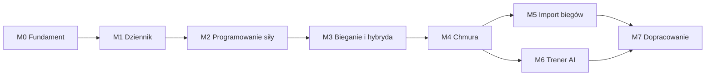

# 09 · Plan wdrożenia

Budowa idzie kamieniami milowymi. Każdy kończy się działającą, wdrożoną wersją, której da się używać na iPhonie.

Kolejność wynika z priorytetu użytkownika: **najpierw dziennik treningów i raporty postępów, potem automatyczne programowanie**.

## 1. Przegląd

| KM | Nazwa | Efekt dla użytkownika | Rozmiar |
|---|---|---|---|
| M0 | Fundament | Pusta aplikacja zainstalowana na iPhonie, działa offline | mały |
| M1 | Dziennik | Wpisywanie treningów siłowych i biegów, historia, rekordy, raporty postępów | duży |
| M2 | Programowanie siły | Aplikacja sama wylicza ciężary i powtórzenia, prowadzi tygodnie i bloki | duży |
| M3 | Bieganie i hybryda | Programowanie biegów, układ tygodnia hybrydowego, samopoczucie, kolejne bloki | duży |
| M4 | Chmura | Logowanie, synchronizacja, kopia, wiele urządzeń | średni |
| M5 | Import biegów | Biegi z zegarka Garmin trafiają do aplikacji same; import plików | średni |
| M6 | Trener AI | Propozycje bloków, komentarz do raportu tygodnia, polecenia tekstowe | średni |
| M7 | Dopracowanie | Funkcje „zaraz po MVP” i „później” według potrzeb | otwarty |

**MVP = M0 + M1.** Po M1 aplikacja nadaje się do codziennego użytku jako dziennik: wpisujesz treningi i widzisz postępy. Automatyczne programowanie, które jest wymaganiem obowiązkowym całego produktu, dochodzi w M2 (siła) i M3 (bieganie i hybryda). Silnik startuje wtedy z historią zebraną w M1.

Do M4 dane żyją na jednym urządzeniu, z eksportem do pliku jako kopią i przypomnieniem o kopii. M4 można przesunąć wcześniej, jeśli synchronizacja okaże się ważniejsza. M5 i M6 są niezależne od siebie.

## 2. Kamienie milowe

### M0 · Fundament

**Zakres**

- Projekt: Vite, React, TypeScript, Tailwind, Dexie, Zod, Hono, konfiguracja Workera z plikami statycznymi.
- PWA: manifest, ikony, service worker, baner aktualizacji.
- Powłoka: cztery zakładki, motyw ciemny i jasny, komponenty bazowe.
- Warstwa danych: koperta dokumentu, repozytoria, pierwsza wersja bazy lokalnej, prośba o trwały magazyn.
- Jakość: lint z regułami granic modułów, sprawdzanie typów, Vitest, Playwright, CI.
- Wdrożenie na Cloudflare.

Baza D1 nie jest potrzebna przed M4 i dopiero wtedy zostanie podłączona.

**Gotowe, gdy**

- Aplikacja pod adresem HTTPS instaluje się na ekranie głównym iPhone'a i uruchamia bez sieci.
- Dane zapisane w zainstalowanej aplikacji przetrwają jej zamknięcie i ponowne uruchomienie telefonu.
- `GET /api/health` odpowiada z produkcji.
- CI przechodzi; wdrożenie to jedna komenda albo automat po wypchnięciu zmian.

**Potrzebne od użytkownika:** dostęp Claude do repozytorium na GitHubie; konto Cloudflare (połączone z repozytorium albo token API).

### M1 · Dziennik

**Zakres**

- Biblioteka ćwiczeń (około 120) i własne ćwiczenia; ustawienia ćwiczenia; notatki.
- „Moje treningi”: sesje układane ręcznie albo z gotowego szablonu podziału.
- Ekran „Dziś” w trybie dziennika: wybór treningu do wpisania, bieg, trening dowolny.
- Ekran sesji: serie wypełnione wynikiem z poprzedniego razu, odhaczanie serii, całego ćwiczenia i całej sesji, edycja serii, zamiana, dodanie i usunięcie ćwiczenia, wpis po fakcie z datą treningu, wznowienie przerwanej sesji, raport z treningu.
- Ręczny wpis biegu: dystans, czas, RPE, typ.
- Waga ciała.
- Historia treningów, historia ćwiczenia, wykres e1RM, rekordy, dodanie i edycja treningu z dowolną datą.
- Raporty: raport tygodnia (wykonane treningi, serie na partię, rekordy, kilometraż, zmiana względem poprzedniego tygodnia).
- Eksport i import JSON; przypomnienie o kopii.

**Wymagania:** FR-ONB-6, 10 · FR-PLAN-10 · FR-STR-1–8, 10–12, 15, 18, 19 · FR-RUN-3, 6 · FR-RDY-6 · FR-EDIT-2, 7–9 · FR-PROG-1–5, 8, 9 · FR-AI-5 · FR-SYNC-1, 2, 8 · FR-SYS-4.

**Gotowe, gdy**

- Pełną sesję siłową da się wpisać offline na iPhonie; seria jak ostatnio to jedno dotknięcie, całe ćwiczenie także.
- Trening taki jak poprzedni da się wpisać po fakcie w nie więcej niż 5 dotknięć.
- Scenariusz S19 (kolejność według daty treningu) przechodzi jako test.
- Historia ćwiczenia pokazuje wszystkie wykonania i wykres e1RM; rekord jest oznaczany przy zapisie.
- Raport tygodnia zgadza się z wpisanymi treningami i działa bez sieci.
- Test przepływu: ułożenie treningu → wpis sesji → zamknięcie aplikacji w połowie → wznowienie → raport → historia i raport tygodnia.
- Eksport z jednej instalacji i import do pustej odtwarzają pełny stan.

### M2 · Programowanie siły

**Zakres**

- Kreator w części siłowej; generowanie szkieletu tygodnia z szablonów albo przejęcie „Moich treningów”.
- Silnik: progresja (tabela decyzji), kalibracja nowych ćwiczeń, RIR w tygodniach bloku, deload, powrót po przerwie, stagnacja, wyjaśnienia „Dlaczego?”.
- Tygodnie i zaplanowane sesje; przejście na nowy tydzień.
- Plan: widok tygodnia, edycja szkieletu, przenoszenie, pomijanie, nadpisanie recepty; zmiany użytkownika mają pierwszeństwo.
- Ekran „Dziś” w trybie programowanym: dzisiejsza sesja z receptą.

**Wymagania:** FR-ONB-1, 4, 6, 8 · FR-PLAN-1–3, 5 · FR-STR-1 (recepta), 9 · FR-ENG-1–3, 7–9 · FR-EDIT-1, 4–6, 10.

**Gotowe, gdy**

- Scenariusze silnika S1–S6, S13, S16, S17 przechodzą jako testy.
- Po włączeniu programowania ćwiczenia z historią z M1 dostają receptę bez kalibracji.
- Po zakończeniu sesji kolejna recepta wynika z tabeli decyzji i ma wyjaśnienie.
- Nowy tydzień generuje się sam, także offline.

### M3 · Bieganie i hybryda

**Zakres**

- Silnik biegowy: VDOT, tempa, przepisy akcentów, progresja kilometrażu, aktualizacja formy.
- Kreator w części biegowej i cele; sesja biegowa z receptą; wynik testu.
- Harmonogram hybrydowy; korekta objętości nóg.
- Samopoczucie: pytanie, flagi, modyfikacje, zamienniki przy bólu, wykrywanie zmęczenia.
- Cykl planu: realizacja, powtórzenie tygodnia, pauza i powrót, wcześniejszy deload.
- Kolejny blok z reguł; ekran propozycji; dziennik zmian i cofanie.
- Walidator limitów z ostrzeżeniami przy edycji.
- Realizacja planu i raport bloku; widok bloku.

**Wymagania:** FR-ONB-2, 3, 5, 7, 9 · FR-PLAN-4, 6 (silnik), 7, 8 · FR-RUN-1, 2, 7 · FR-RDY-1–5 · FR-ENG-4–6, 11 · FR-EDIT-3, 11–13 · FR-PROG-5 (VDOT), 6, 7.

**Gotowe, gdy**

- Scenariusze S7–S12, S14, S15, S18 przechodzą jako testy.
- Nowy tydzień ma układ zgodny z regułami hybrydowymi.
- Samopoczucie 2 zmienia receptę zgodnie z tabelą i nie wpływa na kolejną progresję.
- Po tygodniu deloadu pojawia się propozycja kolejnego bloku; bez reakcji plan idzie dalej.

### M4 · Chmura

**Zakres**

- API: logowanie kluczem dostępu, sesja, ograniczenie prób, nagłówki bezpieczeństwa.
- D1: tabela dokumentów, licznik zmian, migracje.
- Synchronizacja: klient, wyzwalanie, ponawianie, wskaźnik stanu.
- Eksport z serwera i usuwanie danych.

**Wymagania:** FR-SYNC-3–7 · NFR-7, 13.

**Gotowe, gdy**

- Dwa konteksty przeglądarki po zalogowaniu zbiegają do tego samego stanu, także po edycjach offline.
- Tydzień wygenerowany niezależnie na dwóch urządzeniach nie tworzy duplikatów.
- Nowe urządzenie po zalogowaniu odtwarza pełną historię.
- Bez ciasteczka sesji API odpowiada 401; szósta błędna próba logowania jest odrzucana.

**Potrzebne od użytkownika:** wygenerowanie klucza dostępu (skrypt) i zapisanie go w menedżerze haseł.

### M5 · Import biegów

**Zakres**

- Sprawdzenie Garmin Personal API na żywym kluczu ([08 §3.3](08-integracje.md#33-sprawdzenie-przed-budow%C4%85-pierwsze-zadanie-m5)) i aktualizacja dokumentacji.
- Integracja Garmin: zapis klucza, pobieranie cykliczne i na żądanie, wygaśnięcie klucza.
- Import plików FIT, GPX, TCX.
- Dopasowanie do planu, duplikaty, karta potwierdzenia, zmiana przypisania.

**Wymagania:** FR-RUN-4, 5, 9 · FR-INT-1–6.

**Gotowe, gdy**

- Bieg zarejestrowany zegarkiem pojawia się w aplikacji bez ręcznych kroków i jest przypisany do właściwej jednostki.
- Ten sam bieg zaimportowany dwiema drogami nie tworzy duplikatu.
- Wygasły klucz daje czytelny komunikat, a aplikacja działa dalej.

**Potrzebne od użytkownika:** klucz Garmin Personal API wygenerowany na koncie Garmin Connect.

### M6 · Trener AI

**Zakres**

- Budowa kontekstu na urządzeniu z filtrem źródeł danych.
- Punkty API z budżetem, limitem dziennym i licznikiem zużycia.
- Prompty i schematy odpowiedzi; strumieniowanie.
- Propozycja bloku, komentarz do raportu tygodnia, polecenia tekstowe; wspólny ekran propozycji.
- Zestaw kontrolny do oceny jakości.

**Wymagania:** FR-AI-1–4, 6, 7 · FR-PLAN-6 (AI).

**Gotowe, gdy**

- Zestaw kontrolny: wszystkie odpowiedzi zgodne ze schematem, żadna pozycja nie łamie walidatora, elementy przypięte bez zmian.
- Polecenie „od… do… mam tylko hantle” tworzy zmianę na zakres dat, a plan po tym okresie wraca do normy.
- Po przekroczeniu budżetu aplikacja przechodzi w tryb bez AI bez błędów.

**Potrzebne od użytkownika:** klucz API Anthropic z ustawionym limitem wydatków.

### M7 · Dopracowanie

Lista do wyboru po kilku tygodniach używania:

- Serie rozgrzewkowe z podpowiedzią, drop sety, superserie (FR-STR-13, 14, 17).
- Korekta ciężaru w trakcie sesji (FR-STR-16).
- Progresja objętości w bloku (FR-ENG-10).
- Trening siłowy z zegarka jako podpowiedź do wpisu (FR-INT-7).
- Fazy pod start z datą (FR-PLAN-9); strefy tętna (FR-RUN-8).
- Inne aktywności jako obciążenie (FR-RUN-10).
- Przypomnienia push (FR-SYS-5).
- Strojenie parametrów silnika na podstawie rzeczywistych danych.

## 3. Zasady pracy

- **Dokumentacja jest źródłem prawdy.** Zmiana decyzji zaczyna się od zmiany dokumentu, potem kodu.
- **Silnik najpierw testem.** Każda reguła z dokumentu 03 ma test przed implementacją w interfejsie.
- **Każdy kamień milowy jest wdrożony** i sprawdzony na iPhonie przed rozpoczęciem kolejnego.
- **Zakres pilnują priorytety** z dokumentu 02. Pomysły spoza zakresu trafiają do M7.
- **Parametry silnika** zmienia się w jednym pliku konfiguracyjnym, z uzasadnieniem w opisie zmiany.

## 4. Definicja ukończenia (dla każdego kamienia)

- Wymagania z zakresu spełnione, kryteria „Gotowe, gdy” potwierdzone.
- Testy jednostkowe i przepływów przechodzą w CI; brak błędów typów i lintu.
- Działa offline tam, gdzie wymaga tego NFR-1.
- Sprawdzone ręcznie na iPhonie w aplikacji zainstalowanej z ekranu głównego.
- Dokumentacja zaktualizowana o odstępstwa i nowe decyzje.

## 5. Co przygotować

| Kiedy | Co | Koszt |
|---|---|---|
| Teraz | Dostęp Claude do repozytorium GitHub (instalacja aplikacji Claude na repozytorium) | 0 zł |
| M0 | Konto Cloudflare; repozytorium połączone z Cloudflare albo token API | 0 zł |
| M4 | Klucz dostępu do aplikacji (generowany skryptem) | — |
| M5 | Klucz Garmin Personal API (konto Garmin Connect) | 0 zł |
| M6 | Klucz API Anthropic z limitem wydatków | według zużycia, szacunkowo 1–3 USD / mies. |
| Opcjonalnie | Własna domena | około 40–60 zł / rok |

Adres aplikacji powinien pozostać stały od pierwszej instalacji. Dane zainstalowanej aplikacji są przypisane do adresu, więc zmiana adresu (np. przejście na własną domenę) wymaga eksportu i importu danych.

## 6. Ryzyka realizacyjne

| Ryzyko | Kiedy | Reakcja |
|---|---|---|
| Utrata danych z telefonu przed M4 (usunięcie ikony aplikacji usuwa jej dane) | M1–M3 | Eksport do pliku, przypomnienie o kopii co 7 dni; w razie potrzeby M4 wcześniej |
| Ekran sesji niewygodny w praktyce | M1 | Test na siłowni przed zamknięciem M1; poprawki mają pierwszeństwo przed nowymi funkcjami |
| Zachowanie PWA na iPhonie (instalacja, trwałość danych, klawiatura numeryczna) | M0–M1 | Test na docelowym iPhonie już w M0 |
| Reguły progresji okażą się zbyt ostrożne lub zbyt agresywne | Po M2 | Parametry w konfiguracji; strojenie po 2–3 tygodniach danych |
| Garmin Personal API działa inaczej, niż opisano, albo ma niekorzystne warunki | M5 | Eksperyment na początku M5; plan zapasowy: import plików |
| Zmiany w API Claude lub cenach | M6 | Model i ceny w konfiguracji; funkcja jest opcjonalna |
