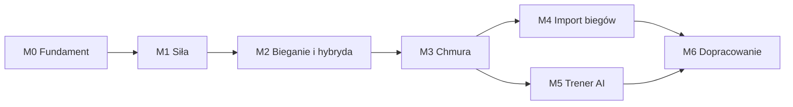

# 09 · Plan wdrożenia

Budowa idzie kamieniami milowymi. Każdy kończy się działającą, wdrożoną wersją, której da się używać na telefonie.

## 1. Przegląd

| KM | Nazwa | Efekt dla użytkownika | Rozmiar |
|---|---|---|---|
| M0 | Fundament | Pusta aplikacja zainstalowana na telefonie, działa offline | mały |
| M1 | Siła | Plan siłowy, logowanie serii, automatyczna progresja | duży |
| M2 | Bieganie i hybryda | Pełny plan hybrydowy, samopoczucie, bloki i deload | duży |
| M3 | Chmura | Logowanie, synchronizacja, kopia, wiele urządzeń | średni |
| M4 | Import biegów | Biegi z zegarka trafiają do aplikacji same; import plików | średni |
| M5 | Trener AI | Propozycje bloków, podsumowania tygodnia, polecenia tekstowe | średni |
| M6 | Dopracowanie | Funkcje „zaraz po MVP” i „później” według potrzeb | otwarty |

**MVP = M0 + M1 + M2.** Po M2 aplikacja spełnia główny cel: sama programuje trening hybrydowy i pozwala go wygodnie logować. Do M3 dane żyją na jednym urządzeniu, z eksportem do pliku jako kopią.

Kolejność M2 i M3 można odwrócić, jeśli kopia w chmurze ma być wcześniej. M4 i M5 są niezależne od siebie.

## 2. Kamienie milowe

### M0 · Fundament

**Zakres**

- Projekt: Vite, React, TypeScript, Tailwind, Dexie, Zod, Hono, konfiguracja Workera z plikami statycznymi i lokalnym D1.
- PWA: manifest, ikony, service worker, baner aktualizacji.
- Powłoka: cztery zakładki, motyw ciemny i jasny, komponenty bazowe.
- Warstwa danych: koperta dokumentu, repozytoria, pierwsza wersja bazy lokalnej.
- Jakość: lint z regułami granic modułów, sprawdzanie typów, Vitest, Playwright, CI.
- Wdrożenie na Cloudflare.

**Gotowe, gdy**

- Aplikacja pod adresem HTTPS instaluje się na ekranie głównym telefonu i uruchamia bez sieci.
- `GET /api/health` odpowiada z produkcji.
- CI przechodzi; wdrożenie to jedna komenda.

**Potrzebne od użytkownika:** konto Cloudflare i token API do wdrożeń.

### M1 · Siła

**Zakres**

- Biblioteka ćwiczeń (około 120) i szablony podziałów.
- Onboarding w części siłowej; generowanie szkieletu tygodnia.
- Ekran „Dziś”, ekran sesji, edycja serii, timer przerw, zamiana ćwiczenia, zakończenie sesji, wznowienie przerwanej sesji.
- Silnik: progresja (tabela decyzji), kalibracja, RIR w tygodniach bloku, deload, powrót po przerwie, wyjaśnienia.
- Plan: widok tygodnia, edycja sesji i szkieletu, przenoszenie, pomijanie, sesja spoza planu.
- Własne ćwiczenia, ustawienia ćwiczenia, notatki.
- Historia treningów i ćwiczenia, wykres e1RM, rekordy.
- Eksport i import JSON.

**Wymagania:** FR-ONB-1, 3, 4, 6, 8 · FR-PLAN-1, 2, 3, 5 · FR-STR-1–12, 15, 18 · FR-ENG-1, 2, 7, 8, 9 · FR-EDIT-1, 2, 4–9 · FR-PROG-1–3 · FR-SYNC-1, 2 · FR-SYS-4.

**Gotowe, gdy**

- Scenariusze silnika S1–S6, S13, S16, S17 przechodzą jako testy.
- Pełna sesja siłowa daje się przeprowadzić offline na telefonie; seria zgodna z planem to jedno dotknięcie.
- Po zakończeniu sesji kolejna recepta wynika z tabeli decyzji i ma wyjaśnienie.
- Test przepływu: onboarding → sesja → zamknięcie aplikacji w połowie → wznowienie → zakończenie → kolejna recepta.

### M2 · Bieganie i hybryda

**Zakres**

- Silnik biegowy: VDOT, tempa, przepisy akcentów, progresja kilometrażu, aktualizacja formy.
- Onboarding w części biegowej i cele.
- Sesja biegowa: recepta, wpis ręczny, bieg spoza planu, wynik testu.
- Harmonogram hybrydowy; korekta objętości nóg.
- Samopoczucie: pytanie, flagi, modyfikacje, zamienniki przy bólu, wykrywanie zmęczenia.
- Cykl planu: przejście tygodnia, realizacja, powtórzenie tygodnia, pauza i powrót, wcześniejszy deload.
- Kolejny blok z reguł; ekran propozycji; dziennik zmian i cofanie.
- Walidator limitów z ostrzeżeniami przy edycji.
- Postępy biegowe i realizacja planu; widok bloku.

**Wymagania:** FR-ONB-2, 5, 7, 9 · FR-PLAN-4, 6 (silnik), 7, 8 · FR-RUN-1–3, 6, 7 · FR-RDY-1–5 · FR-ENG-3–6, 11 · FR-EDIT-3, 10–13 · FR-PROG-5, 6.

**Gotowe, gdy**

- Scenariusze S7–S12, S14, S15 przechodzą jako testy.
- Nowy tydzień generuje się sam, także offline, z układem zgodnym z regułami.
- Samopoczucie 2 zmienia receptę zgodnie z tabelą i nie wpływa na kolejną progresję.
- Po tygodniu deloadu pojawia się propozycja kolejnego bloku; bez reakcji plan idzie dalej.

### M3 · Chmura

**Zakres**

- API: logowanie kluczem dostępu, sesja, ograniczenie prób, nagłówki bezpieczeństwa.
- D1: tabela dokumentów, licznik zmian, migracje.
- Synchronizacja: klient, wyzwalanie, ponawianie, wskaźnik stanu.
- Eksport z serwera i usuwanie danych.

**Wymagania:** FR-SYNC-3–7 · NFR-7, 13.

**Gotowe, gdy**

- Dwa konteksty przeglądarki po zalogowaniu zbiegają do tego samego stanu, także po edycjach offline.
- Tydzień wygenerowany niezależnie na dwóch urządzeniach nie tworzy duplikatów.
- Nowe urządzenie po zalogowaniu odtwarza pełną historię.
- Bez ciasteczka sesji API odpowiada 401; szósta błędna próba logowania jest odrzucana.

**Potrzebne od użytkownika:** wygenerowanie klucza dostępu (skrypt) i zapisanie go w menedżerze haseł.

### M4 · Import biegów

**Zakres**

- Sprawdzenie Garmin Personal API na żywym kluczu ([08 §3.3](08-integracje.md#33-sprawdzenie-przed-budow%C4%85-pierwsze-zadanie-m4)) i aktualizacja dokumentacji.
- Integracja Garmin: zapis klucza, pobieranie cykliczne i na żądanie, wygaśnięcie klucza.
- Import plików FIT, GPX, TCX.
- Dopasowanie do planu, duplikaty, karta potwierdzenia, zmiana przypisania.

**Wymagania:** FR-RUN-4, 5, 9 · FR-INT-1–6.

**Gotowe, gdy**

- Bieg zarejestrowany zegarkiem pojawia się w aplikacji bez ręcznych kroków i jest przypisany do właściwej jednostki.
- Ten sam bieg zaimportowany dwiema drogami nie tworzy duplikatu.
- Wygasły klucz daje czytelny komunikat, a aplikacja działa dalej.

**Potrzebne od użytkownika:** klucz Garmin Personal API (jeśli używa Garmina); potwierdzenie decyzji w sprawie Stravy.

### M5 · Trener AI

**Zakres**

- Budowa kontekstu na urządzeniu z filtrem źródeł danych.
- Punkty API z budżetem, limitem dziennym i licznikiem zużycia.
- Prompty i schematy odpowiedzi; strumieniowanie.
- Propozycja bloku, podsumowanie tygodnia, polecenia tekstowe; wspólny ekran propozycji.
- Zestaw kontrolny do oceny jakości.

**Wymagania:** FR-AI-1–6 · FR-PLAN-6 (AI).

**Gotowe, gdy**

- Zestaw kontrolny: wszystkie odpowiedzi zgodne ze schematem, żadna pozycja nie łamie walidatora, elementy przypięte bez zmian.
- Polecenie „od… do… mam tylko hantle” tworzy zmianę na zakres dat, a plan po tym okresie wraca do normy.
- Po przekroczeniu budżetu aplikacja przechodzi w tryb bez AI bez błędów.

**Potrzebne od użytkownika:** klucz API Anthropic z ustawionym limitem wydatków.

### M6 · Dopracowanie

Lista do wyboru po kilku tygodniach używania:

- Serie rozgrzewkowe z podpowiedzią, drop sety, superserie (FR-STR-13, 14, 17).
- Korekta ciężaru w trakcie sesji (FR-STR-16).
- Progresja objętości w bloku (FR-ENG-10).
- Serie na partię w postępach, podsumowanie bloku (FR-PROG-4, 7).
- Waga ciała (FR-RDY-6).
- Fazy pod start z datą (FR-PLAN-9); strefy tętna (FR-RUN-8).
- Inne aktywności jako obciążenie (FR-RUN-10).
- Przypomnienia push (FR-SYS-5).
- Pierwszy plan z opisu (FR-AI-7).
- Strojenie parametrów silnika na podstawie rzeczywistych danych.

## 3. Zasady pracy

- **Dokumentacja jest źródłem prawdy.** Zmiana decyzji zaczyna się od zmiany dokumentu, potem kodu.
- **Silnik najpierw testem.** Każda reguła z dokumentu 03 ma test przed implementacją w interfejsie.
- **Każdy kamień milowy jest wdrożony** i sprawdzony na telefonie przed rozpoczęciem kolejnego.
- **Zakres pilnują priorytety** z dokumentu 02. Pomysły spoza zakresu trafiają do M6.
- **Parametry silnika** zmienia się w jednym pliku konfiguracyjnym, z uzasadnieniem w opisie zmiany.

## 4. Definicja ukończenia (dla każdego kamienia)

- Wymagania z zakresu spełnione, kryteria „Gotowe, gdy” potwierdzone.
- Testy jednostkowe i przepływów przechodzą w CI; brak błędów typów i lintu.
- Działa offline tam, gdzie wymaga tego NFR-1.
- Sprawdzone ręcznie na telefonie w aplikacji zainstalowanej z ekranu głównego.
- Dokumentacja zaktualizowana o odstępstwa i nowe decyzje.

## 5. Co przygotować

| Kiedy | Co | Koszt |
|---|---|---|
| M0 | Konto Cloudflare, token API | 0 zł |
| M3 | Klucz dostępu do aplikacji (generowany skryptem) | — |
| M4 | Klucz Garmin Personal API (konto Garmin Connect) | 0 zł |
| M5 | Klucz API Anthropic z limitem wydatków | według zużycia, szacunkowo 1–3 USD / mies. |
| Opcjonalnie | Własna domena | około 40–60 zł / rok |

## 6. Ryzyka realizacyjne

| Ryzyko | Kiedy | Reakcja |
|---|---|---|
| Garmin Personal API działa inaczej, niż opisano, albo ma niekorzystne warunki | M4 | Eksperyment na początku M4; plan zapasowy: import plików |
| Reguły progresji okażą się zbyt ostrożne lub zbyt agresywne | Po M1 | Parametry w konfiguracji; strojenie po 2–3 tygodniach danych |
| Ekran sesji niewygodny w praktyce | M1 | Test na siłowni przed zamknięciem M1; poprawki mają pierwszeństwo przed nowymi funkcjami |
| Ograniczenia PWA na konkretnym telefonie (timer, ekran) | M1 | Test na docelowym urządzeniu w M0–M1 |
| Zmiany w API Claude lub cenach | M5 | Model i ceny w konfiguracji; funkcja jest opcjonalna |
